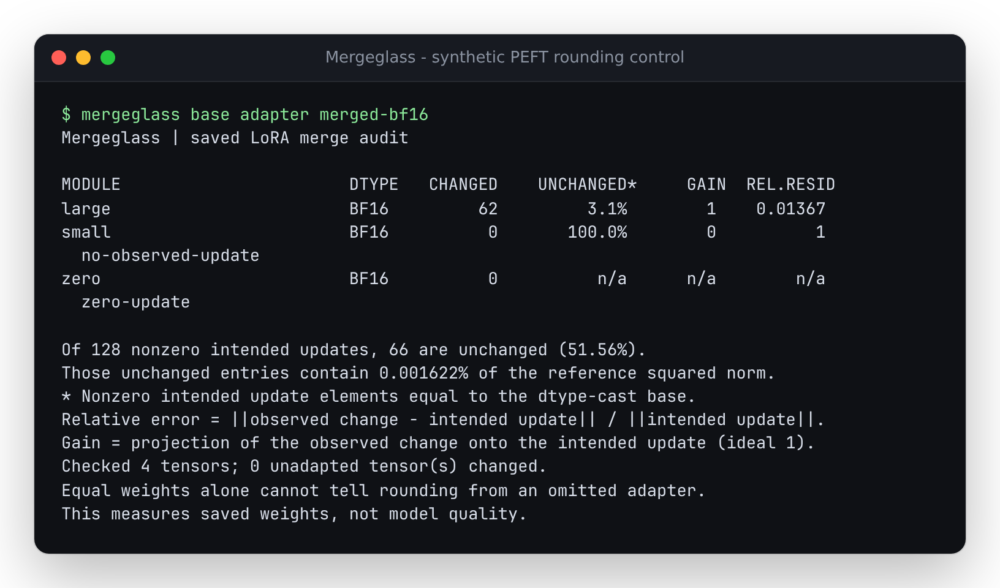

# Mergeglass

**Did the LoRA update survive the merge? Inspect the saved weights.**

[](LICENSE)

A nonzero adapter does not guarantee a changed checkpoint. Small updates can
round away when added to lower-precision base weights; a copied base or a wrong
adapter can also leave a plausible-looking artifact. Mergeglass compares the
original base, the saved LoRA factors and the actual merged safetensors. It
reports what changed, what stayed equal, and the residual against the intended
update, with original tensor coordinates and artifact hashes.



## Checked on a public adapter

For the unchanged
[hfm8tr SmolLM2/SmolTalk adapter](https://huggingface.co/hfm8tr/smollm2-135m-smoltalk-lora/tree/fb39c7012c3b125f94d2bb1a093254994053f4ca),
native PEFT merges of a pinned SmolLM2-135M base produced:

| Saved merge | Nonzero intended update entries | Entries unchanged from base | Share unchanged | Reference squared norm at unchanged entries |
| --- | ---: | ---: | ---: | ---: |
| FP32 | 13,271,040 | 105 | 0.000791% | 1.24e-13% |
| BF16 | 13,271,040 | 5,886,980 | 44.36% | 15.05% |

All 60 adapted matrices had some observed change. All 212 unadapted tensors
matched their dtype-cast bases. An independent dense PyTorch oracle agreed with
the measurements. The unchanged BF16 entries contain 15.05% of the reference
update's squared norm; smaller and larger entries count equally in the 44.36%
figure. Neither fraction measures lost quality or retained observed energy.
The adapter's original training revision and
quality are not independently established. The merges were made locally from
the exact pinned artifacts; no third-party weights are redistributed here.
[Inputs, producer, complete measurements and reproduction](studies/community/README.md).

Actual forwards provide a separate measurement. On six authored probes with
146 shared prefix positions, FP32 merging changed no greedy next-token choices
relative to the unmerged adapter; BF16 merging changed six. Mean probability
total variation was 0.000001612 and 0.02337044, respectively. These short probes
compare numerical behavior, **not accuracy or free-running generation**.
[Runtime settings, original token IDs and complete results](studies/forward/README.md).

## Try the recorded example

With Python 3.10+ and [uv](https://docs.astral.sh/uv/):

```sh
git clone https://github.com/antonsoo/mergeglass && cd mergeglass
uv sync --locked --no-dev
uv run --no-dev mergeglass examples/rounding/base examples/rounding/adapter examples/rounding/merged-bf16 --json report.json
```

The bundled files are native PEFT outputs from **synthetic training with explicit
post-training scale controls**. The `small` adapter changes 31 of 64 weights in
FP32 and zero in BF16. `large` retains a substantial update. `zero` has a zero
reference update and undefined relative ratios. Switch the last input to
`examples/rounding/merged-f32`, `omitted`, or `unrelated-edit` to inspect those
different artifacts. [Producer and independent replay](studies/native-peft/README.md).

Install from this source checkout. There is no PyPI release or hosted service;
the auditor does not download models.

## Changed is not the same as correctly merged

Native PEFT controls on a synthetic two-layer Llama all change **every one of
3,072 adapted entries**: a correct merge, reloading the adapter onto already
merged weights, reversing its sign, and loading the wrong trained adapter.
Signed projection separates these cases: gain about 1, 2, -1, and near 0,
respectively. JSON also records cosine similarity to distinguish direction from
magnitude. The report measures those differences without guessing their cause.

Another control loads rsLoRA factors with standard LoRA scaling; the rank-4
layers have gain 0.5 and the rank-2 layer has gain 0.707107. Two finite BF16
artifacts differ in 755 saved entries solely from PEFT's `safe_merge` operation
sequence. [Native controls, complete receipts and reproduction](studies/merge-controls/README.md).

## Use your checkpoints

```sh
mergeglass ./original-base ./saved-adapter ./merged-model --json merge-report.json
mergeglass ./original-base ./saved-adapter ./merged-model --block-mib 4 --json -
```

Use `uv run --no-dev mergeglass` in place of `mergeglass` when using the source
environment above. Base and merged inputs accept a safetensors file or a Hugging
Face directory; the adapter directory needs `adapter_config.json` and its
safetensors. Indexed shards and ordinary Hugging Face snapshot symlinks work.
All paths are local. The JSON destination must be outside the input directories
and cannot resolve to an input file.

Exit 0 means the audit completed, including when it finds absent updates or
unrelated edits. Exit 2 means invalid/unsupported evidence or an I/O failure.
There is no universal residual threshold that certifies a correct merge.

```python
from mergeglass import audit

report = audit("original-base", "saved-adapter", "merged-model", block_mib=16)
for layer in report["layers"]:
    print(layer["module"], layer["status"], layer["relative_residual"])
```

## What it measures

```text
Saved A, B, alpha/rank --> float64 intended update ---+
                                                    +--> residual + coordinates
Base --> cast to merged dtype --> compare to merge --+
            |
            +--> base conversion drift, kept separate
```

- Per matrix: changed entries, nonzero updates with no observed change, update
  and residual norms, squared-reference norm at unchanged positions, signed
  projection gain, cosine similarity, relative
  residual and the largest residual's row/column.
- Across the checkpoint: every unadapted tensor checked against its cast base,
  with unrelated changes retained individually. Large integer values stay exact.
- Plain Linear LoRA, rsLoRA and supported rank/alpha overrides; BF16, F16, F32
  and F64 storage. Unknown variants and incomplete inventories refuse.
- JSON with schema version, arithmetic definitions, original file hashes,
  full module identities, concrete measurements and limitations.

The numerical reference is `(float64(B) @ float64(A)) * scale`. The observed
change is `merged - cast(base, merged_dtype)`. Comparing against the cast base
separates conversion noise from the added adapter. Relative residual is
`norm(observed - intended) / norm(intended)`; zero denominators are null.

An unchanged nonzero update is evidence of absence, not a diagnosis of its
cause. Changing every entry is also insufficient: a wrong scale or sign can
leave a large residual. Operation order, intermediate dtypes and matrix kernels
can differ from the binary64 reference.
[Exact field contract, supported formats and limits](docs/arithmetic.md).

## Memory and verification

Only A is decoded in full. The auditor reads B, base and merged rows in blocks
and never allocates a full-layer dense update. NumPy and the Rust safetensors
validator are its only runtime dependencies; PyTorch and PEFT belong to the
separate verification environment.

A measured synthetic 4096 x 8192, rank-8 case checks all 33,554,432 weights.
A single full binary64 delta would occupy 256 MiB. The default 16 MiB block
setting measured about 60 MiB process peak RSS on this 14-vCPU, 48-GB WSL2 Linux
machine with one BLAS thread. This is a local measurement; the block setting is
not a hard RSS cap. A, headers, BLAS and at least one full row also need memory.
[Benchmark method and complete results](studies/streaming/README.md).

Verification includes native FP32/F16/BF16 PEFT artifacts, a sharded two-layer
Llama trained locally on labelled synthetic tokens, the public adapter above,
and independent dense PyTorch measurements. A separate oracle checks all
adjacent finite BF16 bit-pattern midpoints and their binary64 neighbors:
195,840 cases, zero direct-cast disagreements. A float32 intermediate disagrees
on 65,280 of those deliberately chosen boundary cases.
[Rounding oracle](studies/rounding/README.md).

## Limits

- Supply the original base weights. A model name does not establish training
  identity, and the auditor does not reconstruct an unseen architecture.
- Coverage is the saved A/B pairs. If both factors are absent, metadata alone
  cannot establish that the missing pair should have existed.
- Quantized weights, DoRA, embedding/conv/Conv1D LoRA, extra trained biases,
  modules-to-save and base-mutating initializers are unsupported. Complex
  rank/alpha regexes and unknown configuration fields refuse explicitly.
- A single saved orientation flag can hide mixed Conv1D targets. Known GPT-2,
  OpenAI GPT and ImageGPT Conv1D paths refuse when their model metadata is
  present. Tensor shapes alone cannot certify arbitrary module types.
  [Native before/after evidence](studies/orientation/README.md).
- This is a numerical saved-weight inspection. It does not certify inference
  equivalence, generation quality, adapter provenance or deployment readiness.
- All tensors are read and all artifact files are hashed. Huge checkpoints
  still require local I/O time. Concurrent saves can invalidate an audit.

## Development

```sh
uv sync --locked
uv run ruff check .
uv run ruff format --check .
uv run mypy src
uv run pytest
uv build
```

The wheel contains the library and CLI; the source distribution includes the
examples and studies. Heavy native-producer dependencies are optional and
documented separately. [Contributing](CONTRIBUTING.md) describes the evidence bar.
[Public source and installed verification](docs/publication.md) retains the
archive and package identities for the published implementation snapshot.

## License

MIT, copyright 2026 Anton Soloviev. The small constructed fixtures are ours.
Public study inputs retain their upstream terms and are fetched to a throwaway
directory; their weights are not included in this repository.
