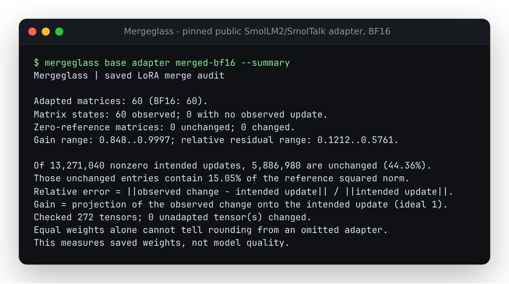
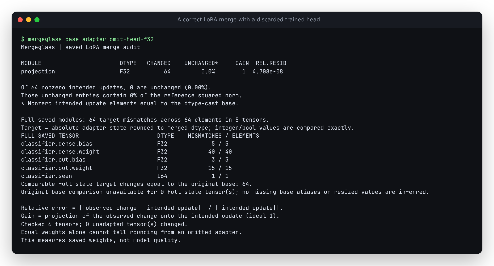
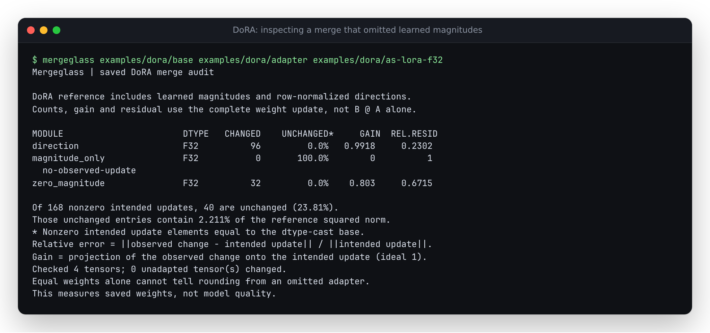
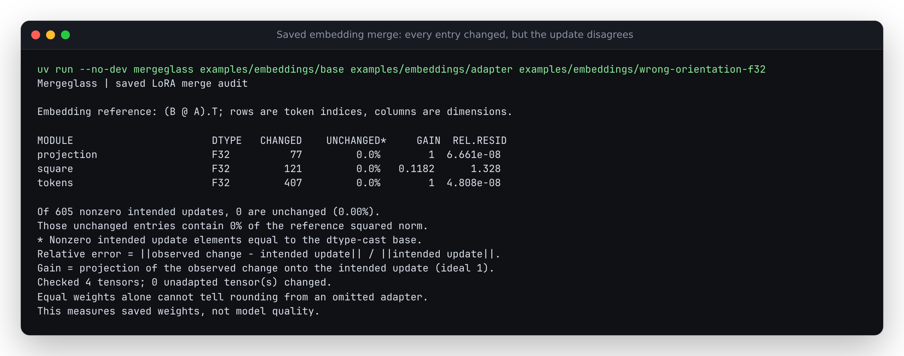

# Mergeglass

**Did the adapter update survive the merge? Inspect the saved weights.**

[](LICENSE)

A nonzero adapter does not guarantee a changed checkpoint. Small updates can
round away when added to lower-precision base weights; a copied base or a wrong
adapter can also leave a plausible-looking artifact. Mergeglass compares the
original base, the saved LoRA/DoRA adapter and the actual merged safetensors. It
reports what changed, what stayed equal, and the residual against the intended
update, with original tensor coordinates and artifact hashes.
It also checks complete trained modules saved beside the factors, such as
embedding tables and classifier heads, against their absolute saved values.



## Checked on a public adapter

For the unchanged
[hfm8tr SmolLM2/SmolTalk adapter](https://huggingface.co/hfm8tr/smollm2-135m-smoltalk-lora/tree/fb39c7012c3b125f94d2bb1a093254994053f4ca),
native PEFT merges of a pinned SmolLM2-135M base produced:

| Saved merge | Nonzero intended update entries | Entries unchanged from base | Share unchanged | Reference squared norm at unchanged entries |
| --- | ---: | ---: | ---: | ---: |
| FP32 | 13,271,040 | 105 | 0.000791% | 1.24e-13% |
| FP16 | 13,271,040 | 973,661 | 7.34% | 0.1044% |
| BF16 | 13,271,040 | 5,886,980 | 44.36% | 15.05% |

All 60 adapted matrices had some observed change. All 212 unadapted tensors
matched their dtype-cast bases. An independent dense PyTorch oracle agreed with
the measurements. The unchanged BF16 entries contain 15.05% of the reference
update's squared norm; smaller and larger entries count equally in the 44.36%
figure. Neither fraction measures lost quality or retained observed energy.
The adapter's original training revision and
quality are not independently established. The merges were made locally from
the exact pinned artifacts; no third-party weights are redistributed here.
[Inputs, producer, complete measurements and reproduction](studies/community/README.md).

Actual forwards provide a separate measurement. On six authored probes with
146 shared prefix positions, FP32 merging changed no greedy next-token choices
relative to the unmerged adapter; FP16 changed one and BF16 changed six. Mean
probability total variation was 0.000001612, 0.00326107 and 0.02337044, respectively.
These short probes
compare numerical behavior, **not accuracy or free-running generation**.
[Runtime settings, original token IDs and complete results](studies/forward/README.md).
With identical named weights, switching the attention path also changes some
BF16 next-token choices. [Matched eager/SDPA comparison](studies/forward/attention.md).

## Try the recorded example

With Python 3.10+ and [uv](https://docs.astral.sh/uv/):

```sh
git clone https://github.com/antonsoo/mergeglass && cd mergeglass
uv sync --locked --no-dev
uv run --no-dev mergeglass examples/rounding/base examples/rounding/adapter examples/rounding/merged-bf16 --json report.json
```

The bundled files are native PEFT outputs from **synthetic training with explicit
post-training scale controls**. The `small` adapter changes 31 of 64 weights in
FP32 and zero in BF16. `large` retains a substantial update. `zero` has a zero
reference update and undefined relative ratios. Switch the last input to
`examples/rounding/merged-f32`, `omitted`, or `unrelated-edit` to inspect those
different artifacts. [Producer and independent replay](studies/native-peft/README.md).

Install from this source checkout. There is no PyPI release or hosted service;
the auditor does not download models.

## Changed is not the same as correctly merged

Native PEFT controls on a synthetic two-layer Llama all change **every one of
3,072 adapted entries**: a correct merge, reloading the adapter onto already
merged weights, reversing its sign, and loading the wrong trained adapter.
Signed projection separates these cases: gain about 1, 2, -1, and near 0,
respectively. JSON also records cosine similarity to distinguish direction from
magnitude. The report measures those differences without guessing their cause.

Another control loads rsLoRA factors with standard LoRA scaling; the rank-4
layers have gain 0.5 and the rank-2 layer has gain 0.707107. Two finite BF16
artifacts differ in 755 saved entries solely from PEFT's `safe_merge` operation
sequence. [Native controls, complete receipts and reproduction](studies/merge-controls/README.md).

## Full trained modules need their own audit

A converter can retain every LoRA update and still discard a trained head or
token table. PEFT saves these through `modules_to_save` as full replacement
weights, so they need an absolute comparison against the saved adapter state.

On the unchanged public
[Kibalama SmolLM2 adapter](https://huggingface.co/Kibalama/smollm2-finetune-python-2/tree/8612b1f0feaeb3d34005848813d13387a13a901f),
the native FP32 merge copies both full modules correctly. An authored control
restores their original values while retaining all 210 native LoRA merges:
39,791,249 of the 56,623,104 full-module values then differ from their targets.
The control changes next-token choices at 7 of 12 deterministic token-ID probe
positions. This measures a deliberately faulty conversion, not model quality
or an observed incident rate.

```sh
uv run --no-dev mergeglass examples/saved-modules/base examples/saved-modules/adapter examples/saved-modules/omit-head-f32
```



The small included synthetic classifier has the same failure: all LoRA weights
remain correct, while 64 full-state values differ, including an integer buffer.
The auditor also accepts explicit replacement embeddings with a changed shape
and saved heads absent from the original tensor inventory. Their target values
are checked completely; unavailable original-base comparisons stay null.
[Native/public inputs, independent checks, controls and limits](studies/saved-modules/README.md).
This support is in the source; no registry release accompanies it.

## DoRA magnitudes must survive too

The source checkout now audits ordinary Linear **DoRA** adapters. Their saved
magnitude vectors are part of the reference; `B @ A` alone is insufficient.
In a native PEFT control, discarding the magnitudes still changes every weight
in the `direction` matrix. Another matrix has a zero factor product but a
nonzero magnitude update, which that incorrect merge loses entirely:

| Saved FP32 merge | Matrix | Changed entries | Relative residual |
| --- | --- | ---: | ---: |
| Correct DoRA | `direction` | 96 / 96 | 7.39e-8 |
| Loaded as ordinary LoRA | `direction` | 96 / 96 | 0.2302 |
| Correct DoRA | `magnitude_only` | 40 / 40 | 8.92e-8 |
| Loaded as ordinary LoRA | `magnitude_only` | 0 / 40 | 1 |



These are labelled synthetic training and explicit post-training controls,
not measured rates in deployed models. Inspect the incorrect merge locally:

```sh
uv run --no-dev mergeglass examples/dora/base examples/dora/adapter examples/dora/as-lora-f32
```

Replace the last directory with `examples/dora/correct-f32-safe-false` to compare.
The old CLI refused all 12 native DoRA cases. The extension checks FP32/F16/BF16
merges, both native safe-merge modes, rsLoRA scales, rank/alpha overrides and
an actual sharded Transformers save. A dense PyTorch oracle and a separate
80-digit scalar calculation check the reference. Missing magnitudes and
undefined zero directions refuse. [Artifacts, arithmetic, memory and reproduction](studies/dora/README.md).
This capability is available in the public source; no package-registry release
accompanies it. [Public source bytes](studies/dora/results/publication.json)
match the verified implementation.

The [public-artifact replay](studies/dora/README.md#unchanged-public-dora-artifacts)
also checks a pinned SmolLM2 DoRA adapter across 210 adapted matrices and a
separately published checkpoint. A local BF16 merge leaves 32.48% of its nonzero
reference entries unchanged, containing 4.58% of the reference squared norm.
A controlled FP32 merge that drops magnitudes changes nearly every entry but
has relative residuals of 0.114 to 0.220. These are saved-weight measurements, not
model-quality scores or proof of the original training base.

The current source also separates **full-row norm factors and directions**.
In the native plain-LoRA control, directions remain nearly parallel to the DoRA
reference while row norms range from 0.5863 to 1.555 times the learned target;
four zero targets are saved nonzero. Zero rows stay explicit, and factored
lengths retain observations beyond float64's ordinary norm range.
[Closed-form controls and native row measurements](docs/dora-rows.md).

When the original base is unavailable, `mergeglass --dora-norms ADAPTER MERGED`
still compares saved row lengths with the learned magnitudes. Its separate
partial report leaves directions, complete updates and unmapped tensors
unmeasured. A matching norm cannot establish a correct merge.
[No-base example and report contract](docs/dora-without-base.md).

A separate [matched native inference replay](studies/function-calls/README.md)
now records 658 questions across six execution profiles. The FP32 merge produces
the same greedy token IDs as unmerged FP32 on all 658 questions; matched BF16
merging changes 298 sequences, and a local FP32 control that omits magnitudes
changes 134. At 18,453 shared selected-answer prediction positions, the respective
argmax disagreement counts are 0, 283 and 73.

The omitted-magnitude control also has lower selected-answer loss on 596 of 656
questions despite its incorrect row norms. These observations keep weight
fidelity, likelihood and generated-call grades separate. The training prompt
and training overlap are unknown. The study retains all native outputs,
unknown outcomes, a standalone figure and an archive that reproduces its
aggregates without a model runtime.

## Token embeddings need the transpose

The source audits **Embedding LoRA** alongside Linear LoRA. PEFT stores
embedding weights as `[vocabulary, dimensions]`, so their update is `(B @ A).T`.
A square matrix can hide a missing transpose: in a native controlled merge all
121 entries change, but its gain is 0.1182 and relative residual is 1.328.
The correct FP32 merge's residual is 6.72e-8. An omitted-embedding control changes
the Linear layer correctly while leaving both embedding updates absent.



These are synthetic training and explicit wrong-merge controls, not measured
incident rates. Try the included artifacts:

```sh
uv run --no-dev mergeglass examples/embeddings/base examples/embeddings/adapter examples/embeddings/wrong-orientation-f32
```

Rows and residual coordinates retain the original token indices. Default PEFT
saves containing a base-layer copy are accepted only after checking that copy
against the supplied original base. A 32,000,384-weight native embedding merge
measured 44.6 MiB peak RSS at a 1 MiB block setting; its full float64 update alone
would occupy 244 MiB. Embedding B stays decoded while vocabulary-wide A is streamed.
[Native FP32/F16/BF16 cases, scalar oracle, memory method and limits](studies/embeddings/README.md).
This extension is available from this repository's `main` branch. The registry
package has not been released with this support; build or install the source.

## Use your checkpoints

```sh
mergeglass ./original-base ./saved-adapter ./merged-model --json merge-report.json
mergeglass ./original-base ./saved-adapter ./merged-model --summary --json merge-report.json
mergeglass ./original-base ./saved-adapter ./merged-model --block-mib 4 --json -
```

Use `uv run --no-dev mergeglass` in place of `mergeglass` when using the source
environment above. Base and merged inputs accept a safetensors file or a Hugging
Face directory; the adapter directory needs `adapter_config.json` and its
safetensors. Indexed shards and ordinary Hugging Face snapshot symlinks work.
All paths are local. The JSON destination must be outside the input directories
and cannot resolve to an input file.

`--summary` shows checkpoint totals, matrix states and gain/residual ranges.
It performs the same complete audit and retains every layer in JSON.

Exit 0 means the audit completed, including when it finds absent updates or
unrelated edits. Exit 2 means invalid/unsupported evidence or an I/O failure.
There is no universal residual threshold that certifies a correct merge.

```python
from mergeglass import audit

report = audit("original-base", "saved-adapter", "merged-model", block_mib=16)
for layer in report["layers"]:
    print(layer["module"], layer["status"], layer["relative_residual"])
```

## What it measures

```text
Saved A, B, alpha/rank --> float64 intended update ---+
                                                    +--> residual + coordinates
Base --> cast to merged dtype --> compare to merge --+
            |
            +--> base conversion drift, kept separate
```

- Per matrix: changed entries, nonzero updates with no observed change, update
  and residual norms, squared-reference norm at unchanged positions, signed
  projection gain, cosine similarity, relative
  residual and the largest residual's row/column.
- Across the checkpoint: every unadapted tensor checked against its cast base,
  with unrelated changes retained individually. Large integer values stay exact.
- Complete modules saved through `modules_to_save`: absolute target mismatches,
  cast drift, error norms and original-base changes where comparable. Full
  module biases and integer/bool buffers are included.
- Linear LoRA and DoRA, Embedding LoRA, rsLoRA and supported rank/alpha overrides; BF16, F16, F32
  and F64 storage. Finite [signed alpha coefficients](studies/signed-scale/README.md)
  keep their declared sign.
  Unknown variants and incomplete inventories refuse.
- JSON with schema version, arithmetic definitions, original file hashes,
  full module identities, concrete measurements and limitations.

The numerical reference is `(float64(B) @ float64(A)) * scale`. The observed
change is `merged - cast(base, merged_dtype)`. Comparing against the cast base
separates conversion noise from the added adapter. Relative residual is
`norm(observed - intended) / norm(intended)`; zero denominators are null.
For DoRA, the intended update is the complete row-normalized, magnitude-scaled
weight minus the original base, rather than the factor product alone.

An unchanged nonzero update is evidence of absence, not a diagnosis of its
cause. Changing every entry is also insufficient: a wrong scale or sign can
leave a large residual. Operation order, intermediate dtypes and matrix kernels
can differ from the binary64 reference.
[Exact field contract, supported formats and limits](docs/arithmetic.md).

## Memory and verification

In a full audit, Linear A or Embedding B is decoded in full. The auditor reads
the other factor, DoRA magnitudes, optional base snapshots, full saved modules,
base and merged in blocks
and never allocates a full-layer dense update. NumPy and the Rust safetensors
validator are its only runtime dependencies; PyTorch and PEFT belong to the
separate verification environment.

On the public SmolLM2 BF16 case above, a fresh installed CLI process checks
272 tensors across 540,004,492 input-file bytes at **61.24 MiB peak RSS** on this
host. It loads no model class or PyTorch. This is a single local measurement;
the block option is a workspace target rather than a hard process limit.
[Method and retained input/module identities](studies/streaming/README.md).

A measured synthetic 4096 x 8192, rank-8 case checks all 33,554,432 weights.
A single full binary64 delta would occupy 256 MiB. The default 16 MiB block
setting measured about 60 MiB process peak RSS on this WSL2 Linux host with
14 logical CPUs and one BLAS thread. This is a local measurement; the block setting is
not a hard RSS cap. A, headers, BLAS and at least one full row also need memory.
[Benchmark method and complete results](studies/streaming/README.md).

Verification includes native FP32/F16/BF16 PEFT artifacts, a sharded two-layer
Llama trained locally on labelled synthetic tokens, the public adapter above,
and independent dense PyTorch measurements. A separate oracle checks all
adjacent finite BF16 bit-pattern midpoints and their binary64 neighbors:
195,840 cases, zero direct-cast disagreements. A float32 intermediate disagrees
on 65,280 of those deliberately chosen boundary cases.
[Rounding oracle](studies/rounding/README.md).

## Limits

- Supply the original base weights for a complete audit. The optional DoRA
  norm-only mode provides partial observations without one. A model name does not establish training
  identity, and the auditor does not reconstruct an unseen architecture.
- Coverage is the saved A/B pairs and explicit full-module state. If both
  factors are absent, metadata alone cannot establish that a pair should have
  existed. Saved-module selectors without an observed tensor prefix are
  reported separately; no architecture or missing alias is inferred.
- Quantized weights, Embedding DoRA, conv/Conv1D adapters, LoRA `bias`/`lora_bias`
  options and base-mutating initializers are unsupported. Complex
  rank/alpha regexes and unknown configuration fields refuse explicitly.
- DoRA uses one saved magnitude per output row and the supplied original base.
  It does not emulate producer-specific intermediate precision or reconstruct
  a different base used during merging. Zero directions are undefined even
  with a zero magnitude. Counts describe the declared binary64 reference.
- A single saved orientation flag can hide mixed Conv1D targets. Known GPT-2,
  OpenAI GPT and ImageGPT Conv1D paths refuse when their model metadata is
  present. Tensor shapes alone cannot certify arbitrary module types.
  [Native before/after evidence](studies/orientation/README.md).
- This is a numerical saved-weight inspection. It does not certify inference
  equivalence, generation quality, adapter provenance or deployment readiness.
- All tensors are read and all artifact files are hashed. Huge checkpoints
  still require local I/O time. Concurrent saves can invalidate an audit.

## Development

```sh
uv sync --locked
uv run ruff check .
uv run ruff format --check .
uv run mypy src
uv run pytest
uv build
```

The wheel contains the library and CLI; the source distribution includes the
examples and studies. Heavy native-producer dependencies are optional and
documented separately. [Contributing](CONTRIBUTING.md) describes the evidence bar.
[Public source and installed verification](docs/publication.md) retains the
archive and package identities for the published implementation snapshot.

## License

MIT, copyright 2026 Anton Soloviev. The small constructed fixtures are ours.
Public study inputs retain their upstream terms and are fetched to a throwaway
directory; their weights are not included in this repository.
