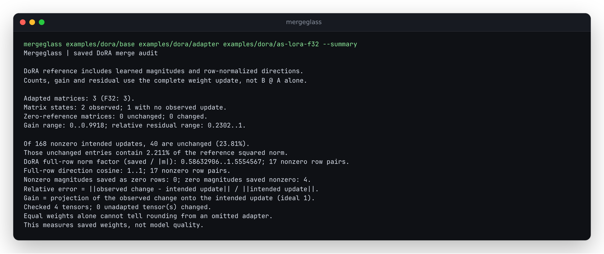

# DoRA: inspect the learned norm and the full row's direction

DoRA writes each output row as `m * unit(base + scale * B @ A)`. Its norm
is therefore `abs(m)`; a negative magnitude reverses the reference direction.
The complete-update gain and residual remain the main audit measurements.
The optional `layers[].dora_rows` observations explain the full saved rows
in the parameterization DoRA actually learns:

- **Norm factor:** saved row norm divided by `abs(saved magnitude)`.
  One matches the learned norm; one half saves half that norm.
- **Direction cosine:** saved row versus the float64 full reference row,
  including the magnitude sign. One is parallel and minus one is reversed.
- **Zero rows:** zero targets saved nonzero, and nonzero targets saved zero,
  have their own counts. Neither receives a fabricated ratio or cosine.



Reproduce that deliberately incorrect merge:

```sh
uv run --no-dev mergeglass examples/dora/base examples/dora/adapter \
  examples/dora/as-lora-f32 --summary
```

This is an authored native PEFT control: its configuration was deliberately
loaded as plain LoRA. Direction cosines round to one, but the nonzero norm
factors range from **0.5863 to 1.555**. Four zero-magnitude targets are saved
as nonzero rows. The metrics describe the observed weights; they do not
identify the cause of an unknown user's artifact.

## Independent controls

With base rows `[3, 4]`, zero A/B and the following saved magnitudes, a
3-4-5 triangle establishes every observation without a matrix library:

| Saved row | Saved m | Norm factor | Direction cosine | Zero observation |
| --- | ---: | ---: | ---: | --- |
| `[3, 4]` | 10 | 0.5 | 1 | Neither |
| `[6, 8]` | -10 | 1 | -1 | Neither |
| `[3, 4]` | 0 | Unavailable | Unavailable | Zero target saved nonzero |
| `[0, 0]` | 5 | Unavailable | Unavailable | Nonzero target saved zero |
| `[0, 10]` | 10 | 1 | 0.8 | Neither |

The [tests](../tests/test_dora.py) retain this five-row audit, all-zero targets,
the original row identity beyond a block boundary, and extreme finite weights.
The [dense oracle](../studies/dora/row_diagnostics.py) separately uses PyTorch's
row norm and cosine operations on all twelve native DoRA cases and four public
artifact/control cases: 877 matrices and 622,359 rows.

| Public/control artifact | Full-row norm factor range | Minimum direction cosine |
| --- | --- | ---: |
| Published FP32 checkpoint | 0.9999997675 to 1.0000002359 | 0.9999999999999971 |
| Local FP32 merge | 0.9999997675 to 1.0000002359 | 0.9999999999999971 |
| Local BF16 merge | 0.9986923 to 1.0011716 | 0.9999980 |
| Controlled plain-LoRA FP32 merge | 0.9902755 to 1.0109495 | 0.9999999999999971 |

These use the [pinned public DoRA inputs](../studies/dora/README.md#unchanged-public-dora-artifacts).
The published checkpoint agrees tensor-for-tensor with a native local FP32
merge in the earlier study. The deliberately wrong plain-LoRA artifact is a
local control, not the author's published checkpoint.

## Range, zeros and interpretation

Lengths are computed from scaled rows; no raw weight is squared. Ratios retain
a log2 form: zero means a factor of one, +1 means twice the norm and -1 means
half. Near one, factored ratios avoid subtracting logarithms of huge/tiny norms.
An unrepresentable ordinary factor is JSON null while its finite log2 value
remains available. A saved norm exceeding float64 range retains its scale and
scaled length. A null range means there were no comparable nonzero row pairs.
Directions have no epsilon floor; zero numerical reference rows remain explicit.

`largest_nonzero_log2_norm_error` names the original output row with the largest
absolute log2 norm factor. It excludes zero-row cases, whose counts remain
separate. The diagnostic is an unweighted row view, not a magnitude-weighted
whole-checkpoint norm. Its cosine is for full rows, unlike the existing cosine
between observed and intended **updates**.

Small full-row changes can still destroy a small adapter update. The BF16 case
above has near-unit row factors while erasing 32.48% of its nonzero intended
update entries. Matching norms and printed cosines therefore do not replace
exact reference-cast counts, full-update residuals or an actual task evaluation.
Older schema-1 reports without `dora_rows` still render; ordinary LoRA reports
do not gain DoRA-specific observations. No runtime dependency is added.
## Installed verification

The [retained receipt](../studies/dora/rows/verification.json) identifies source
`a418fabef253097c6836736a57b63ccd5b4ec193`, the wheel, and the source archive.
All seven runtime Python files in the wheel, both isolated installations, and
the dense-oracle run match that source byte for byte. Python 3.10 with NumPy
1.24.0 / safetensors 0.6.2 and Python 3.15 with NumPy 2.5.4 / safetensors 0.8.0
each ran the 89 checks and reproduced the terminal capture. Neither installed
auditor imports PyTorch or PEFT.

The compressed [dense measurements](../studies/dora/rows/dense-oracle.json.gz)
retain every matrix, input fingerprint and row witness. The
[compatibility replay](../studies/dora/rows/compatibility.json.gz) compares
34 real/native/control cases against source `59b7391`: every earlier JSON field
and the rendering of earlier reports are identical. Only the documented row
observations and their arithmetic description are added to DoRA reports.

The [installed streaming run](../studies/dora/rows/streaming.json.gz) checks
33,554,432 native PEFT weight entries against an independent closed form.
Peak process RSS was 38.94 / 62.21 / 135.16 MiB for 1 / 16 / 64 MiB block
targets, with zero residual and zero reference-cast mismatches. Block size is
a workspace target, not a process memory cap. Concurrent inference makes the
recorded elapsed times unsuitable for a throughput comparison. These are
local artifact measurements; they do not establish a registry release. The
[publication receipt](../studies/dora/rows/publication.json) separately verifies
26 changed files from public immutable GitHub URLs against their git blobs.

Re-run the dense oracle with the optional native producer environment from
[the DoRA study](../studies/dora/README.md), using its generated native directory
and downloaded public directory:

```sh
OPENBLAS_NUM_THREADS=1 PYTHONPATH=src python studies/dora/row_diagnostics.py \
  /tmp/mergeglass-dora/native /tmp/mergeglass-dora/public /tmp/dora-rows.json
```

The raw JSON is compressed only for repository size; the receipt records both
compressed and uncompressed hashes. For example, inspect it with
`gzip -dc studies/dora/rows/dense-oracle.json.gz`.
