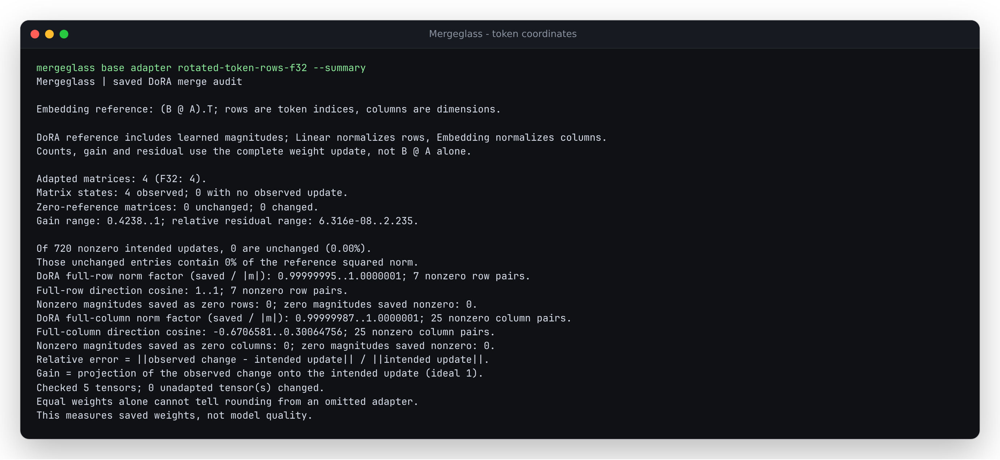
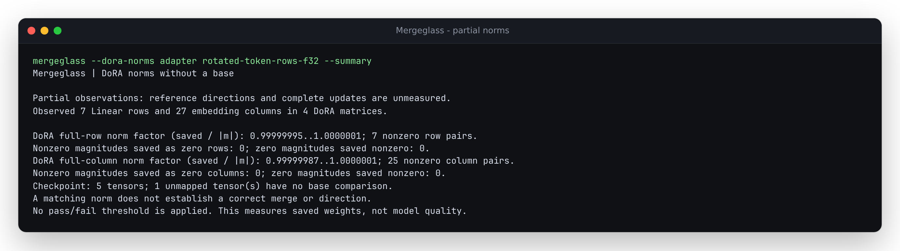

# Embedding DoRA across the complete vocabulary

PEFT stores an embedding weight as `[vocabulary, dimensions]`, with factors
`A: [rank, vocabulary]`, `B: [dimensions, rank]` and a magnitude vector of length
**dimensions**. Native embedding DoRA normalizes each complete vocabulary column.
Reusing Linear's output-row normalization is wrong even when a square shape fits.

The prior source `78acb37` explicitly refuses these adapters. The extension adds
a global column-length pass, then streams complete-reference weights and residuals
in their original token/dimension coordinates. It retains B and per-dimension
statistics, never a full decoded A, transposed checkpoint or full-layer update.

[The arithmetic contract](../../docs/arithmetic.md#embedding-dora) defines the
numerical reference, `dora_columns`, signs, zero directions and snapshot checks.
[The runnable small example](../../examples/embedding-dora/README.md) includes
unchanged native inputs and deliberate wrong-merge controls.

## Native saves and independent arithmetic

[`produce.py`](produce.py) executes PEFT `save_pretrained` and
`merge_and_unload` in the separately [pinned native environment](../native-peft/README.md).
It trains a small mixed model on **synthetic IDs and random regression targets**,
then applies declared zero/signed magnitudes and a zero-product magnitude-only
control. A second, random one-layer Llama trains on synthetic IDs and saves six
native Transformers shards. Both its factor-only and default embedding-snapshot
adapters are retained.

Fifteen artifact cases cover FP32/F16/BF16, both native safe-merge modes,
rsLoRA/rank/alpha overrides, negative Linear alpha, native snapshots, sharded
serialization and controlled omissions/axis/token-coordinate errors.
These are numerical framework checks, not production failure rates or language
quality measurements. [Exact producer receipt](results/producer.json).

[`verify.py`](verify.py) builds complete references with dense binary64 Torch
operations, independently checks every reported count/norm/gain/residual and
saved-coordinate witness, and compares full-vector diagnostics. An 80-digit
Decimal implementation evaluates 1,848 scalar coordinate checks across the
supplied adapters without a matrix operation. Independent adjacent-bit-pattern
rounding avoids the native runtime's F64-to-BF16 double rounding.

The [before receipt](results/before.json) retains all 15 explicit refusals.
The [source replay](results/source.json) and
[isolated installed minimum-version replay](results/installed-310.json) agree
with the independent reference on every case, including deliberately incorrect
saves. Counts and direct-cast comparisons are exact; numerical checks use
relative tolerance `1e-8`, absolute `1e-14`. Complete and partial reports agree
on all shared norm fields. Default saved base snapshots still refuse the
no-base mode; their original-value comparison requires the base.

## Two plausible mistakes

For the saved square embedding, all 121 entries change in each of these files:

| Saved FP32 square | Gain | Relative residual | Nonzero column norm factor range |
|---|---:|---:|---:|
| Native correct merge | 1.00000001 | 8.20e-8 | 0.99999995..1.00000006 |
| Authored row normalization | 0.623475 | 1.092732 | 0.649689..1.478900 |
| Authored token-row rotation | 0.630410 | 2.235384 | 0.99999995..1.00000006 |

The first control scales rows by the dimension magnitudes. A square shape hides
that mismatch. The second permutes saved token rows, retaining each column's
values and nearly matching its magnitude norm while changing which token receives
each vector. Its full-column direction cosine spans `-0.67066..0.28710`.
Norm agreement alone does not establish coordinate fidelity.





The separate magnitude-only embedding has a zero factor product but 115 nonzero
complete-reference updates. Its native merge changes all 115, with relative
residual `1.79e-8`. Resetting only embedding magnitudes to directional norms
leaves all 115 unobserved: gain 0, relative residual 1. Its Linear neighbor
retains the correct DoRA merge.

## Vocabulary-scale memory

[`streaming.py`](streaming.py) produces a native BF16 merge with
250,003 token rows, 128 dimensions and rank 8: **32,000,384 weights**.
The base is one. One A row cycles through 33 exact binary fractions; every
fourth B row is zero and all saved magnitudes are 500. These are explicit
synthetic controls, not trained or pretrained weights.

An independent 80-digit calculation uses integer counts of the 33 groups to
derive complete norms, gains, residuals, unchanged-entry energy and direct BF16
rounding. A separate native SDK process checks **every base and saved entry**,
as well as all factors, against that reference. The measured auditor imports
neither Torch nor PEFT. [Full memory/count receipt](results/memory.json).

| Block workspace target | Fixed-factor limit | Peak RSS | CLI/import elapsed |
|---|---:|---:|---:|
| 1 MiB | 1 MiB | 46.2 MiB | 4.28 s |
| 16 MiB | 1 MiB | 66.2 MiB | 2.24 s |

These are one fresh installed CLI process each on this 14-CPU-affinity WSL2
Linux host with 47.05 GiB reported RAM, one BLAS thread, Python 3.10.21,
NumPy 1.24.0 and safetensors 0.6.2. The independent input scan precedes the
measurements, so filesystem data may be cached. These are observations rather
than statistical timing estimates or hard RSS guarantees.

A full float64 update alone would occupy **244.14 MiB**. A decoded A would need
15.26 MiB, exceeding the fixed-factor limit; retained B needs 8 KiB. Both block
settings agree with the integer-residue reference, including the partial final
group: 6,545,664 changed entries and 25,454,720 unchanged nonzero intended entries.
The block target also permits interpreter/BLAS/header overhead, per-dimension
statistics and at least one complete row.

## Compatibility, provenance and reproduction

All [25 previous example reports](results/legacy.json) and their complete
per-layer/summary terminal output match the prior source exactly, with no
excluded fields. This covers ordinary LoRA/DoRA, embeddings, Conv1D, B bias,
saved modules and expert parameters; four no-base Linear cases also match.
The [reproduction receipt](results/reproduction.json) records 42 unchanged native
output files reproduced byte for byte across the small and large generators.

The [native environment](results/native-environment.json) matches all 37 pinned
packages. Installed PEFT `layer.py`, `dora.py` and `variants.py` also match their
[official v0.21.0 source bytes](results/upstream.json). The embedding variant
uses the transposed base for its vector norm; the saved magnitudes belong to
embedding dimensions independently of the adapter's global orientation flag.

Run production and the dense/scalar verifier with the separate native environment:

```sh
PYTHONHASHSEED=0 OMP_NUM_THREADS=1 OPENBLAS_NUM_THREADS=1 python studies/embedding-dora/produce.py /tmp/embedding-dora-native
PYTHONPATH=src OMP_NUM_THREADS=1 OPENBLAS_NUM_THREADS=1 python studies/embedding-dora/verify.py /tmp/embedding-dora-native /tmp/embedding-dora-source.json
```

Set `PYTHONPATH` to a checkout of `78acb37` and add `--before` for the refusals.
To test an installed auditor, pass `--auditor-python /path/to/venv/bin/python`;
its subprocess uses isolated mode and no source `PYTHONPATH`.

```sh
PYTHONHASHSEED=0 OMP_NUM_THREADS=1 OPENBLAS_NUM_THREADS=1 python studies/embedding-dora/streaming.py produce /tmp/embedding-dora-large
OMP_NUM_THREADS=1 OPENBLAS_NUM_THREADS=1 python studies/embedding-dora/streaming.py measure /tmp/embedding-dora-large --python /path/to/installed/bin/python --out /tmp/embedding-dora-memory.json
```

Production directories must be new. Repeated native saves depend on the pinned
framework versions and seeds; producer receipts identify the files actually read.

## Clean packages and installed CLI

Two fresh clones of source `be6782043f973253a3ea7e80bce905f52be8b4b8` complete
the locked development checks on Python 3.10 and 3.15, including all 181 contract
cases. `uv build` produces a source distribution and builds its wheel from that
distribution. Both wheels match byte for byte, as do both uncompressed source
archives; their gzip streams differ across the build interpreters.
[Commands, artifact hashes and installed identities](results/packages.json),
[3.10 build log](results/clean-310.log), [3.15 build log](results/clean-315.log).

| Isolated installation | Runtime dependencies | Native replay |
|---|---|---|
| Built wheel, Python 3.10.21 | NumPy 1.24.0, safetensors 0.6.2 | [15 cases, 1,848 scalar coordinates](results/installed-310.json) |
| Source distribution, Python 3.15.0 | NumPy 2.5.4, safetensors 0.8.0 | [15 cases, 1,848 scalar coordinates](results/installed-315.json) |

All ten installed runtime modules and all ten modules in each artifact match
the source bytes. Every bundled native example file survives the source
distribution unchanged. Neither installed runtime has Torch or PEFT available.
The four example audits and no-base command run outside the checkout with
isolated Python. Their terminal summaries equal the reviewed screenshots' input.
Complete JSON comparisons exclude no fields: counts and identities are exact;
18 floating norm diagnostics differ across NumPy versions by at most
`1.11e-16` in absolute value. Those differences are retained in the receipt.

The package identities above belong to the pinned feature source; later
documentation receipts change source archives and wheel README metadata.
They leave the verified runtime and native inputs unchanged.

## Public source

The feature revision above is pushed to GitHub. A fresh public HTTPS clone runs
both README example commands with only the normal runtime dependencies; their
summaries equal the reviewed screenshot inputs. A separate forced Git install
resolves that exact commit, preserves all ten runtime module bytes and has no
Torch or PEFT available. Its complete 15-case native replay is byte-identical
to the source-distribution installation receipt.

```sh
uv venv /tmp/embedding-dora-auditor --python 3.15
uv pip install --python /tmp/embedding-dora-auditor/bin/python --force-reinstall 'mergeglass @ git+https://github.com/antonsoo/mergeglass.git@be6782043f973253a3ea7e80bce905f52be8b4b8'
```

The [public-source receipt](results/publication.json) retains the install's
commit metadata, the complete replay identity and exact comparisons of 26
immutable HTTP files: runtime modules, native examples, study scripts and
reviewed PNGs. This establishes public source and the observed install; it
does not claim a registry release, executed CI jobs or a hosted application.

## Boundaries

- The base identity, training provenance, tokenizer and model quality are not
  established. These fixtures do not measure a deployed incident rate.
- Full directions and complete updates require the supplied original base.
  Base-independent observations measure only saved vector lengths and signs.
- Zero direction columns refuse rather than adding an epsilon. Signed and zero
  magnitudes on nonzero directions retain their complete update semantics.
- Snapshots must equal the original base at their declared dtype. Missing,
  ambiguous, nonfinite and unsupported evidence still refuses the whole audit.
- Conv1D DoRA, convolutional/quantized adapters, trained base biases, B-bias
  combinations and other unsupported variants remain outside this extension.
- The float64 reference is numerical, not a native merge emulator. Dtype,
  operation order and reduction order can differ; no correctness threshold
  or model-quality estimate is applied.
- Source publication, installed artifacts and a registry release are separate.
  This extension does not publish a new registry version or hosted application.
