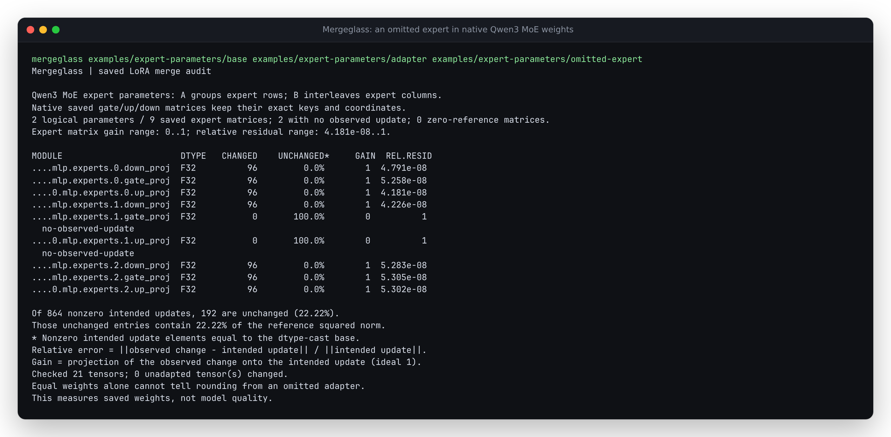

# Follow a fused expert parameter into its saved matrices

A Qwen3 MoE runtime parameter and its saved checkpoint have different shapes.
The native model holds one `gate_up_proj` stack and one `down_proj` stack.
Transformers saves separate `gate_proj`, `up_proj` and `down_proj` weights for
each expert. PEFT's A and B factors also use different expert orderings.
Treating B as a contiguous expert stack produces a complete, plausible-looking
checkpoint with the wrong updates.

Mergeglass now follows this declared producer layout into the **actual saved
keys and coordinates**. It can identify an omitted expert without rebuilding a
model or allocating a dense expert stack. The
[runnable example](../../examples/expert-parameters/README.md) contains native
correct merges and authored omission/order faults.



## Exact mapping

For expert `e`, rank component `k`, logical output `o` and input `i`:

```text
delta[e,o,i] = sum_k B[o,k*experts+e] * A[e*rank+k,i] * scale

runtime gate_up_proj[e, 0:I, :]  -> experts.e.gate_proj.weight
runtime gate_up_proj[e, I:2I, :] -> experts.e.up_proj.weight
runtime down_proj[e, :, :]      -> experts.e.down_proj.weight
```

A groups expert rows; B interleaves expert columns. When both logical parameters
are selected, PEFT wraps `gate_up_proj` first, then `down_proj` outside it:

| Saved factor prefix | Logical parameter |
| --- | --- |
| `...experts.lora_A/B.weight` | `...experts.down_proj` |
| `...experts.base_layer.lora_A/B.weight` | `...experts.gate_up_proj` |

Reversing the adapter config's selector order does not reverse this binding.
The producer records original `nn.Parameter` object identities before
injection and the actual native wrapper rank/scale afterward. The independent
verifier uses that record to check every reported binding.

## Native cases and observed faults

The pinned environment is the same as
[the earlier native studies](../native-peft/requirements.txt): PEFT 0.21.0,
Transformers 5.20.1 and CPU Torch. All models, tokens and optimization targets
are synthetic; six optimizer steps make nonzero factors, without a quality
claim.

| Profile | Experts | Selected parameters | Additional coverage |
| --- | ---: | --- | --- |
| `both` | 3 | gate/up and down | ordinary nested wrapping |
| `reversed-rs` | 3 | reversed config order | rsLoRA, rank override, negative alpha |
| `mixed-zero` | 3 | gate/up and down | Linear + Embedding LoRA, full saved head; authored zero expert |
| `singleton-down` | 1 | down only | no expert interleaving ambiguity |
| `two-layer-gate` | 4 | gate/up in two layers | suffix selection, layer rank/alpha overrides |

Each profile runs actual `merge_and_unload` at FP32, FP16 and BF16 with safe
merging both off and on. Additional saved controls omit one expert, omit the
scale, or incorrectly reshape B as a contiguous expert stack. There are
**44 saved merges**, with 211 producer artifacts plus their manifest retained
in [a 162,751-byte archive](artifacts/native.tar.gz).

The `both` profile demonstrates:

| Saved artifact | Affected gate/up gain | Relative residual | Other matrices |
| --- | --- | --- | --- |
| Native FP32 | about 1 | about `4e-8` to `6e-8` | native |
| Authored omitted expert 1 | 0 for expert 1 | 1 for expert 1 | exact native payloads |
| Authored missing scale | about 1/3 | about 2/3 | exact native payloads |
| Authored contiguous B | -0.497 to 0.538 | 0.993 to 1.660 | exact native down payloads |

The mixed profile deliberately zeros one expert's B columns after training.
Its correct merge has a zero reference for that expert. The wrong B ordering
writes nonzero values there, reported as `change-with-zero-reference` with null
gain and relative residual. Zero reference is different from an omitted
nonzero update.

Baseline source `c683a9ee674d642b2e898525621cc30cadcbe852` refuses all 44 inputs
with `Unsupported adapter option: target_parameters`. This adds a previously
unsupported capability; it does not correct an earlier clean result for these
faults. [Before](results/before.json.gz), [complete reports](results/after.json.gz)
and [independent oracle receipt](results/oracle.json.gz) are retained.

## Independent verification and numerical limits

`verify.py` uses a separate stdlib safetensors byte reader and 80-digit Decimal
products, without importing Torch, PEFT or Transformers. It checks **37,920
expert entries**: native factor identity, scale, physical keys, gate/up row
offsets, gain, residual, unchanged counts and largest-residual coordinates.
Every unadapted tensor remains unchanged. All unaffected saved tensor payloads
in authored controls equal the corresponding native FP32 result.

The auditor uses binary64 factor products and rounds the base plus update once
to the saved dtype. Native merges may multiply/add in another precision or
operation order. The oracle brackets rounding decisions with a conservative
binary64 arithmetic interval; none of these fixtures has an ambiguous saved
rounding decision. This is not a guarantee for every adapter. Native FP32
residuals remain nonzero and are retained as measurements.

Actual native forwards use the explicitly selected CPU `eager` expert backend.
Automatic `grouped_mm` rejected a tiny FP16 stride in this fixture, so this
study makes no claim about that backend. Across five profiles and both safe
settings, the largest pre/post merge logit differences are `8.94e-8` (FP32),
`0.00048828125` (FP16) and `0.00390625` (BF16). None of the 480 authored positions
per dtype changes its next-token argmax. This measures these numerical probes,
not accuracy or generation quality.

The native loader emits warnings that rank/alpha patterns were ignored even
though the captured native ranks/scales and saved payloads demonstrate the
overrides. The manifest retains those exact warnings. They are not silently
used to choose a layout. Six pinned upstream files are
[byte-verified against the installed producer](results/producer-source.json),
including PEFT's wrapper/injection code and Transformers' expert serialization.

## Reproduce and supported boundary

```sh
uv sync --locked
mkdir /tmp/mergeglass-experts
tar -xzf studies/expert-parameters/artifacts/native.tar.gz -C /tmp/mergeglass-experts
uv run python studies/expert-parameters/verify.py /tmp/mergeglass-experts /tmp/experts-oracle.json
uv run mergeglass examples/expert-parameters/base examples/expert-parameters/adapter examples/expert-parameters/omitted-expert --json /tmp/omitted-expert.json
```

To regenerate the native producer, install the pinned native requirements in a
separate environment and run `produce.py` with a new output directory. Keep
`HF_HUB_OFFLINE=1`; these models are constructed locally. For baseline refusal,
run the same verifier with `--before` against the baseline source.

The supported contract is standard `Qwen3MoeForCausalLM`, declared Transformers
5.20.1 / PEFT 0.21.0 metadata, literal `gate_up_proj` / `down_proj` selectors and
native expanded per-expert saved weights. It requires complete factors and
physical matrices, matching declared dimensions, and known wrapping order.
Custom/quantized models, other producer versions, repacked 3-D checkpoints,
DoRA or B-bias expert variants, ambiguous selectors and full-module overlap
refuse. No shape fit or measured residual selects a parameter binding.

B and one expert's A slice share the decoded adapter limit. Saved weight rows
are processed in blocks. Each physical matrix contributes once to the usual
matrix totals; `logical_expert_parameters` counts logical parameters separately.
The auditor adds no runtime dependency and never executes model code.

Clean Git archives were checked on Python 3.10.21 and 3.15.0 with locked lint,
formatting, strict types, all 171 tests and package builds. Both wheels are
byte-identical. Fresh wheel consumers byte-match all nine runtime modules,
import no model frameworks, and reproduce all 44 native reports exactly while
passing the independent 37,920-entry calculation. They also run all three
bundled example commands. [Python 3.10](results/clean-310.json),
[Python 3.15](results/clean-315.json),
[installed 3.10](results/installed-310.json),
[installed 3.15](results/installed-315.json).
The earlier 48 Conv1D and 32 bias case reports remain
[identical](results/existing-layouts.json).

Public source `b4b3eea478dacbd4b0c6610bbdf00e2480a9e7c3` was checked through
45 immutable raw file downloads. A fresh HTTPS clone, runtime-only Python 3.10
install, archive extraction, all 44 independent native checks and all three CLI
examples also passed. [Publication receipt](results/publication.json).
This publishes source and reproducible examples; there is no new registry
release or hosted model service.
