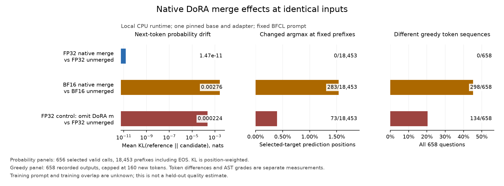

# Matched function-call generations and native probabilities

Weight-space residuals do not establish inference behavior. This optional
study runs the same pinned SmolLM2 DoRA artifacts through six local runtime
profiles, using a fixed prompt protocol and two complete BFCL categories.
The auditor itself still requires neither a model runtime nor PyTorch.

| Profile | Base execution | Adapter execution |
| --- | --- | --- |
| `base-f32` | FP32 | Absent |
| `unmerged-f32` | FP32 | Native PEFT DoRA, FP32 factors |
| `merged-f32` | FP32 | Native saved FP32 merge |
| `unmerged-bf16` | BF16 | Native PEFT DoRA, FP32 factors |
| `merged-bf16` | BF16 | Native saved BF16 merge |
| `as-lora-f32` | FP32 | Local controlled merge with magnitudes omitted |

The [model inputs](../dora/public-sources.json) and
[native merge receipts](../dora/results/public.json) are pinned separately.
The adapter is
[ehyoussef/smollm2-135m-function-dora-adapter](https://huggingface.co/ehyoussef/smollm2-135m-function-dora-adapter/tree/8ce55268048940efdc497bf9ea6d2b45d9eb2ab1);
the supplied base is
[HuggingFaceTB/SmolLM2-135M-Instruct](https://huggingface.co/HuggingFaceTB/SmolLM2-135M-Instruct/tree/12fd25f77366fa6b3b4b768ec3050bf629380bac).
Merged profiles execute the locally produced native controls.
The BF16 comparison includes PEFT's native mixed-precision adapter path and
the saved merge's operation order. It measures the resulting execution profiles;
it does not isolate one final rounding operation as the cause of every difference.
The original training-base revision, training prompt and overlap with BFCL
are unknown. The plain-LoRA artifact is a deliberate local control, not the
author's published checkpoint. This experiment is conditional on the supplied
base, prompt, model runtime and categories; it is not a held-out quality
estimate or a full BFCL leaderboard submission.

## Complete recorded generations

All 658 questions finished in every profile: 3,948 generations in 162 native
chunks. The separate probability cohort contains 656 selected valid calls,
18,453 target prediction positions and 27 native chunks. Every accepted chunk
preserves its named parameters and persistent buffers.

The native FP32 merge produces identical greedy token IDs to unmerged FP32 on
all 658 questions. Native BF16 merging changes 298 of 658 sequences relative
to unmerged BF16. The local omitted-magnitude FP32 control changes 134 of 658
relative to unmerged FP32. The corresponding fixed-prefix argmax disagreements
are 0, 283 and 73 out of 18,453 positions.

[](figures/merge-effects.svg)

[Standalone SVG](figures/merge-effects.svg),
[figure identities](figures/figure.json),
[complete aggregate report](results/summary.json).
The figure's comparisons use the same base execution precision on each native
merge/reference pair. Its probability and greedy panels have different prefixes
and denominators.

| Profile | AST accepted | Rejected | Ungraded | EOS stop | 160-token stop |
| --- | ---: | ---: | ---: | ---: | ---: |
| `base-f32` | 1 | 655 | 2 | 139 | 519 |
| `unmerged-f32` | 3 | 645 | 10 | 503 | 155 |
| `merged-f32` | 3 | 645 | 10 | 503 | 155 |
| `unmerged-bf16` | 3 | 644 | 11 | 508 | 150 |
| `merged-bf16` | 2 | 644 | 12 | 506 | 152 |
| `as-lora-f32` | 3 | 646 | 9 | 500 | 158 |

Under this fixed prompt, most outputs fail the pinned AST decoder. Accepted
counts describe the recorded checker outcomes; no generated function is
executed. Two questions have incomplete required-answer alternatives in every
profile. Additional ungraded outputs contain binary/lambda expressions. Their
counts differ across profiles, so paired outcomes retain the union of unknowns.

For example, the matched BF16 comparison changes one accepted outcome to a
rejection among 645 pairs with both grades known; 13 pairs include an unknown.
The omitted-magnitude control keeps the same outcome in all 648 pairs with
known grades, while 10 pairs include an unknown. Sequence differences, selected
answer likelihood and AST grades remain separate measurements.

The original training prompt, training overlap and training-base revision are
unknown. These results establish this supplied-artifact, CPU-runtime and prompt
comparison. They do not establish the adapter's held-out quality or its behavior
under another prompt. Raw timings come from overlapping workers on a shared
host and are retained for execution audit, without a performance ranking.

## Fixed populations and scoring

[protocol.json](protocol.json) selects all 400 `simple_python` and 258
`live_simple` records at the pinned upstream revision. Each has one function
and one conversation turn. Eleven live records have two user messages within
that turn; both messages are preserved. The wrapper uses BFCL's default Python
prompt and the adapter's pinned tokenizer/chat template. It never truncates
an input; actual model context bounds are checked rather than relying on the
tokenizer's shorter warning threshold.

Generation is greedy with a 160-token cap, native caching, eager attention,
two Torch threads and cached constant DoRA weight norms. Output token IDs,
text, EOS/cap stops, question/prompt hashes, grades and model-state identities
are retained per question. A 16-token control on the first prompt checks
cached versus uncached DoRA norms for each unmerged profile. Every chunk hashes
each tensor in `model.state_dict()` before and after execution and requires
equality. That identity covers parameters and persistent buffers; transient
generation caches and nonpersistent buffers are outside it.

`verify_grader.py` constructs a valid reference call for every answerable
record and requires the unchanged upstream checker to accept it. At this
revision, 656 pass; two live records have empty alternative sets for required
parameters. They remain explicitly ungraded instead of receiving invented
answers or failures. Wrong-name/count/syntax controls are rejected. Binary
and lambda expressions are left ungraded before the upstream resolver's eval
branches; a side-effect control establishes that the wrapper does not execute
that expression. No generated function call is executed.

The longest prompt is 1,166 tokens. The longest selected reference is 164
tokens including EOS (`live_simple_108-65-0`), exceeding the 160-token generation
cap; a shorter valid serialization may exist. The selected-target length is
reported rather than used to invent a missing generation result. Among the 656
questions with selected valid references, the largest prompt-plus-target input
is 1,083 tokens. Neither path truncates.

## Probabilities at identical prefixes

[teacher-forced-protocol.json](teacher-forced-protocol.json) selects one
upstream-accepted call per answerable question, deterministically from the
reference alternatives. The same prompt IDs and selected target-prefix IDs
are supplied to every profile, including the EOS prediction. All other valid
answers remain outside this target-likelihood measurement.

The actual native logits are converted to float64 log probabilities. The
study retains mean target-token negative log likelihood in nats per question,
token-weighted NLL separately, KL(reference || candidate), total variation,
and argmax disagreement. Both unmerged FP32 and unmerged BF16 serve as
probability references. A two-class closed form independently checks the
probability arithmetic. Target likelihood and conditional argmax counts are
not generation success or task accuracy.

### Measured probability differences

All 656 selected valid reference calls are complete across six profiles, with
18,453 prediction positions including EOS. The table uses position-weighted
KL(reference || candidate) and total variation:

| Candidate / reference | Mean KL, nats | Mean total variation | Changed argmax positions |
| --- | ---: | ---: | ---: |
| Native FP32 merge / unmerged FP32 | 1.47e-11 | 1.12e-06 | 0 / 18,453 |
| Native BF16 merge / unmerged BF16 | 0.00276 | 0.0152 | 283 / 18,453 |
| Omit magnitudes in FP32 / unmerged FP32 | 0.000224 | 0.00427 | 73 / 18,453 |

These positions follow the same selected reference prefixes. Greedy generations
follow their own generated prefixes and are checked separately.

The controlled merge with omitted magnitudes has lower selected-call NLL on
596 of 656 questions than unmerged FP32, while the
[saved-weight audit](../../docs/dora-rows.md) measures its incorrect row norms.
Its mean question NLL is 0.9480 nats, versus 0.9577 for native unmerged FP32.
That result keeps answer likelihood separate from fidelity to the intended
DoRA weights. The original training prompt and training overlap are unknown;
these selected-call measurements are conditional on this fixed local protocol.

### Independent checks on actual vocabulary logits

The [fixed native capture](probability-controls/capture.json) revisits the first
and last `simple_python` questions, using the first, middle and EOS prediction
positions. Both reference intervals were already complete; the capture checks
their source, prompt, target and model-state identities. All full-question
measurements reproduce the canonical rows before any sampled logits are saved.

[The actual arrays](probability-controls/logits.npz) retain the complete vocabulary
at those positions across six profiles. Native BF16 values are represented
exactly in float32. No saved probability is used by the independent oracle:
[`check_logits.py`](check_logits.py) normalizes those logits again using NumPy
extended precision, with 63 stored mantissa bits on this Linux host.

All 20 reference/candidate comparisons and selected argmax IDs agree on
[NumPy 1.24 / Python 3.10](probability-controls/numpy-310.json) and
[NumPy 2.5.4 / Python 3.15](probability-controls/numpy-315.json). The largest
absolute scalar difference is 2.54e-14; the receipts retain each comparison and
the combined absolute/relative tolerance. These are two numerical controls,
not full-cohort vocabulary coverage or a quality estimate.

The independent check needs NumPy and the retained arrays, without Torch,
PEFT, model weights or inference:

```sh
python studies/function-calls/check_logits.py studies/function-calls/probability-controls /tmp/mergeglass-logit-check.json
```

## Resumable execution and complete-cohort analysis

`replay.py --prepare-only` produces the full prompt-ID receipt before loading
a model. `run_chunks.py` runs fixed source-order intervals in fresh processes,
records source/library/input identities, and accepts a chunk only after its
before/after weight hashes agree. A restart revalidates completed chunks.
Incomplete directories are retained with an `interrupted` suffix and rerun.
The protocol and source hashes must remain identical across every chunk.

The generation cohort has 658 questions per profile; the teacher-forced
cohort has 656 questions across all six profiles. `--limit` and
`--pilot-records` explicitly mark diagnostic runs; these cannot be passed off
as complete cohorts. The same first two records were run both continuously
and in separate one-record chunks: all non-timing outputs match exactly.

Independent profile workers can compute the same protocol in parallel.
`import_chunks.py` accepts only a fully completed future profile with matching
source, prompt, dependency, interval and weight identities. Stop the master
coordinator during import; its earlier worker can continue computing. The
master subsequently validates those copied receipts through its normal resume
path. No source output is changed or selected by its score.

`run_future.py` can compute a later source-order interval for the currently
active profile of a running coordinator. It retains the native child's exit status, checks
the same prompt/source/model identities, briefly stops the verified owning
coordinator to copy the completed interval, and resumes it. Its current native
worker remains in a different directory. The coordinator subsequently checks
the copied interval in its ordinary loop. Linux process ownership is checked
through `/proc`; existing or competing canonical work is never replaced.

`analyze.py` requires both complete parent receipts, revalidates every chunk,
checks exact question ordering and common weight identities, and reports
paired outcomes without filling unknown grades. It keeps per-question and
token-weighted probability aggregates distinct. Partial outputs are not a
complete-run result.

`check_analysis.py --summary FILE` checks the actual serialized primary
aggregates with independent SQLite JSON queries and binds the check to the
summary and complete parent receipts. It checks both token-weighted and
question-weighted measurements, every reported category subtotal, and the
separate prompt/reference-token budgets. The figure and retention programs require
that checked, complete result. Limited diagnostic cohorts cannot produce a
full-study figure or archive.

`check_generations.py` reconstructs every saved text directly from its token
IDs, using the pinned tokenizer without Transformers. It checks token bounds,
first-EOS termination and the 160-token cap, then regrades every output against
a fresh pinned BFCL checkout. Every grade dictionary must match exactly,
including unknown outcomes. It also compares each imported upstream module
with its Git object and the original chunk receipts. This checks decoding and
grading again; it does not rerun inference or establish model quality.

The separate native Python 3.12 environment uses the
[pinned producer dependencies](../native-peft/requirements.txt), plus
`tree-sitter==0.21.3`, `tree-sitter-java==0.21.0`,
`tree-sitter-javascript==0.21.4`, `python-dotenv==1.2.2` and
`tenacity==9.1.4` for upstream imports. Source hashes and actual versions are
part of each receipt. See [the attribution and scoped wrapper changes](NOTICE.md).

## Reproduce

First prepare the pinned public artifacts and three native controls using
[the DoRA study's instructions](../dora/README.md#unchanged-public-dora-artifacts).
Here `/tmp/mergeglass-dora-public` is that input directory and
`/tmp/mergeglass-producer/bin/python` is the separate producer environment.
The chunk runner uses POSIX file locks.

```sh
uv pip install --python /tmp/mergeglass-producer/bin/python tree-sitter==0.21.3 tree-sitter-java==0.21.0 tree-sitter-javascript==0.21.4 python-dotenv==1.2.2 tenacity==9.1.4
```

Obtain the exact BFCL source and data, without its unrelated repository trees:

```sh
git clone --depth 1 --filter=blob:none --sparse https://github.com/ShishirPatil/gorilla.git /tmp/mergeglass-bfcl
git -C /tmp/mergeglass-bfcl fetch --depth 1 origin f7cf7359b7ac615a0b294831c5ba2bc95ee4a000
git -C /tmp/mergeglass-bfcl checkout --detach f7cf7359b7ac615a0b294831c5ba2bc95ee4a000
git -C /tmp/mergeglass-bfcl sparse-checkout set berkeley-function-call-leaderboard
```

Fetch the four pinned tokenizer files into the existing adapter directory.
This explicit preparation step uses the network; inference stays local:

```sh
python - <<'PY'
import hashlib, json, urllib.request
from pathlib import Path
p = json.loads(Path('studies/function-calls/protocol.json').read_text())
root = Path('/tmp/mergeglass-dora-public/adapter')
for item in p['tokenizer_files']:
    url = (f"https://huggingface.co/{p['tokenizer_repository']}/resolve/"
           f"{p['tokenizer_revision']}/{item['file']}")
    with urllib.request.urlopen(url, timeout=45) as response:
        data = response.read()
    assert len(data) == item['bytes']
    assert hashlib.sha256(data).hexdigest() == item['sha256']
    (root / item['file']).write_bytes(data)
PY
```

Use fresh output directories for preparation and the two complete runs:

```sh
HF_HUB_OFFLINE=1 /tmp/mergeglass-producer/bin/python studies/function-calls/verify_grader.py /tmp/mergeglass-bfcl /tmp/mergeglass-grader-work /tmp/mergeglass-grader.json
HF_HUB_OFFLINE=1 /tmp/mergeglass-producer/bin/python studies/function-calls/replay.py /tmp/mergeglass-dora-public /tmp/mergeglass-bfcl /tmp/mergeglass-prompts --prepare-only
HF_HUB_OFFLINE=1 /tmp/mergeglass-producer/bin/python studies/function-calls/run_chunks.py generate /tmp/mergeglass-dora-public /tmp/mergeglass-bfcl /tmp/mergeglass-prompts/prompts.json /tmp/mergeglass-generations --chunk-size 25
HF_HUB_OFFLINE=1 /tmp/mergeglass-producer/bin/python studies/function-calls/run_chunks.py teacher /tmp/mergeglass-dora-public /tmp/mergeglass-bfcl /tmp/mergeglass-prompts/prompts.json /tmp/mergeglass-probabilities --chunk-size 25
python studies/function-calls/analyze.py /tmp/mergeglass-generations /tmp/mergeglass-probabilities /tmp/mergeglass-prompts/prompts.json /tmp/mergeglass-function-summary.json
python studies/function-calls/check_analysis.py /tmp/mergeglass-generations /tmp/mergeglass-probabilities /tmp/mergeglass-prompts/prompts.json /tmp/mergeglass-function-check.json --summary /tmp/mergeglass-function-summary.json
```

Re-running a chunk command resumes its verified completed intervals. Do not
change the protocol or study sources during a run. Byte differences from a
different producer/kernel require a distinct identified experiment; changing
expected hashes cannot establish equivalence to the retained inputs.

The complete generation check uses a separate environment without Torch,
Transformers or PEFT. Its tokenizer directory contains the four pinned files
prepared above; no model weights are loaded:

```sh
uv venv --python 3.12 /tmp/mergeglass-generation-check
uv pip install --python /tmp/mergeglass-generation-check/bin/python -r studies/function-calls/requirements-check-generations.txt
/tmp/mergeglass-generation-check/bin/python studies/function-calls/check_generations.py /tmp/mergeglass-generations /tmp/mergeglass-prompts/prompts.json /tmp/mergeglass-bfcl /tmp/mergeglass-dora-public/adapter /tmp/mergeglass-regrade-work /tmp/mergeglass-regraded.json
```

For a standalone scientific figure, use a separate plotting environment; do
not change an active producer environment:

```sh
uv venv --python 3.12 /tmp/mergeglass-plots
uv pip install --python /tmp/mergeglass-plots/bin/python -r studies/function-calls/requirements-plots.txt
/tmp/mergeglass-plots/bin/python studies/function-calls/plot.py /tmp/mergeglass-function-summary.json /tmp/mergeglass-function-check.json /tmp/mergeglass-function-figures
```

The plot compares each native merge with its unmerged execution at the same
base precision, and the controlled omitted-magnitude FP32 merge with unmerged
FP32. It keeps teacher-forced prefixes and complete generation cohorts as
separate denominators. Different greedy token sequences do not imply different
task grades. No population interval or held-out performance claim is fitted.

Retain the original record and receipt bytes after both cohorts finish:

```sh
python studies/function-calls/retain.py /tmp/mergeglass-generations /tmp/mergeglass-probabilities /tmp/mergeglass-prompts/prompts.json /tmp/mergeglass-function-summary.json /tmp/mergeglass-function-check.json /tmp/mergeglass-function-retained --bfcl /tmp/mergeglass-bfcl --generation-check /tmp/mergeglass-regraded.json
```

The deterministic archive contains both canonical trees, prompts, the checked
summary, the independent decoding/regrading receipt and any parallel-origin
receipt metadata. The four pinned benchmark
question/answer files and their attribution travel with the archive, so cases
remain readable without model weights or a tokenizer. Shared imported records occur
once in the canonical tree. Its separate compressed manifest retains every
member's size and digest. Native model weights, worker logs and incomplete
attempts are excluded. Every archived byte is compared with its original and
read back from the archive before the retention receipt is written.

### Retained complete evidence

The [3.65 MB native archive](results/native-cohorts.tar.gz) contains 649 original
files: canonical records and receipts, prompt IDs, checked aggregates, origin
metadata, four benchmark question/reference files, and their attribution.
[The archive identity](results/archive.json) and
[compressed member manifest](results/native-cohorts-files.json.gz) bind every
member's bytes. The original outputs and native receipts are stored once;
shared imported records are not duplicated by their origin metadata.

[Independent decoding and regrading](results/generation-check.json) reproduces
all 3,948 saved texts, full grade dictionaries, EOS/cap stops and token bounds
using a fresh pinned upstream checkout and tokenizer. That checker environment
has no Torch, Transformers or PEFT.

[The extracted-archive replay](results/archive-replay.json) checks every member
again, links the raw vocabulary controls to the same native chunks and model
identities, and recomputes the complete report on Python 3.10.21 and 3.15.0.
Both copies match the retained summary byte for byte. Their independent SQLite
queries also agree, using SQLite 3.53.1; the original complete-report check used
SQLite 3.50.4. This replays recorded aggregates on the same host, with no model
inference.

[Fresh input recreation](results/input-recreation.json) regenerates the three
local native controls into another directory: all 30 files match the expected
bytes, and fresh pinned tokenizers/BFCL sources reproduce all 658 prompt IDs
exactly. [The loaded upstream source proof](results/bfcl-source-proof.json)
checks all 22 imported module files against their pinned Git objects.

The independent checker initially missed altered category subtotals and prompt
budgets. [The before/after controls](results/category-check-after.json) retain
that reproduced gap and rejection of all seven targeted corruptions after the
fix. [Current runtime identities](results/core-runtime-identity.json) keep these
research tools separate from the eight unchanged auditor modules in the tested
Python 3.10/3.15 wheel installs. [Verification index](results/verification.json).

[The public-file check](results/publication.json) fetched all 49 changed files
and frozen native sources from commit `67b227b`, including the raw
logit arrays, figure and complete archive. Every file matched its reviewed
Git object byte for byte. This publishes source and study evidence; no registry
release was made.

### Recompute from recorded native outputs

The aggregate analysis and SQLite checker use Python's standard library. With
the same identified study sources, extract the archive and recompute the report:

```sh
mkdir /tmp/mergeglass-recorded
tar -xzf studies/function-calls/results/native-cohorts.tar.gz -C /tmp/mergeglass-recorded
python studies/function-calls/analyze.py /tmp/mergeglass-recorded/generation /tmp/mergeglass-recorded/teacher /tmp/mergeglass-recorded/prompts.json /tmp/mergeglass-recomputed.json
python studies/function-calls/check_analysis.py /tmp/mergeglass-recorded/generation /tmp/mergeglass-recorded/teacher /tmp/mergeglass-recorded/prompts.json /tmp/mergeglass-recomputed-check.json --summary /tmp/mergeglass-recomputed.json
cmp /tmp/mergeglass-recorded/summary.json /tmp/mergeglass-recomputed.json
```

Source, prompt, interval, receipt and model-state identities are rechecked
before aggregation. This reproduces the reported aggregates from recorded
native outputs; the model-inference reproduction uses the producer steps above.
The pinned question/reference files under `benchmark/` keep individual cases
readable without decoding a tokenizer or downloading weights.
