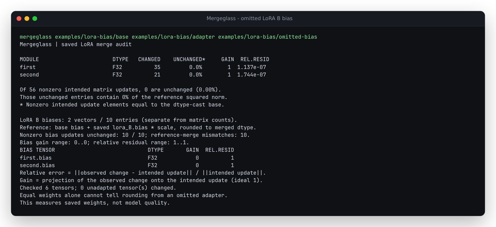

# LoRA B bias is a separate update

`lora_bias: true` adds a trainable bias to PEFT's B projection. A merge must
apply that vector as well as the matrix product:

```text
matrix delta = (B @ A) * scale             # transposed for supported Conv1D
bias delta   = B.bias * scale
saved bias reference = round(base.bias + bias delta)
```

An authored faulty merge can retain every correct matrix while omitting all
bias updates. The [runnable native example](../../examples/lora-bias/README.md)
contains ten such updates. The matrix reports still look correct; the new
separate vector reports show gain 0 and relative residual 1.



## Native producer and controls

`produce.py` uses pinned Torch, PEFT 0.21.0 and Transformers 5.20.1 from the
[native environment](../native-peft/requirements.txt). All models, optimization
targets and faults are synthetic. Four profiles exercise:

| Profile | Matrix layout | Bias vectors | Other evidence |
| --- | --- | ---: | --- |
| `affine` | ordinary Linear | 2 / 10 entries | rank override and negative alpha |
| `bias-only` | ordinary Linear | 2 / 10 entries | only B biases trained; zero matrix delta |
| `affine-saved-head` | ordinary Linear | 2 / 10 entries | rsLoRA and full saved head, including its absolute bias |
| `gpt2-conv1d` | native GPT-2 Conv1D | 4 / 88 entries | rectangular and square projections, rank/alpha overrides |

For each profile, the actual `merge_and_unload` runs at FP32, FP16 and BF16,
with safe merging both off and on. Two extra controls start from the native
FP32 result and change only targeted bias vectors: omit the bias, or add it
without its scale. There are **32 saved merges** in total, including eight
authored faulty conversions. Original matrix payloads and full saved-module
tensors remain byte-identical in those controls.

At baseline revision `49a1fce7330776d88151b9b972b93fa0c0093f4f`, all 32 inputs
refuse with `Unsupported adapter option: lora_bias`. This was an explicit
unsupported capability, not a previous clean audit of the faulty merges.
[Before](results/before.json) and [complete after reports](results/after.json.gz)
retain the boundary.

The affine example produces:

| Saved artifact | Matrix payloads | First bias gain | Second bias gain | Nonzero bias updates unchanged |
| --- | --- | ---: | ---: | ---: |
| Native FP32 | actual native merge | about 1 | about 1 | 0 / 10 |
| Authored omission | same native matrices | 0 | 0 | 10 / 10 |
| Authored missing scale | same native matrices | about 1/3 | about -1 | 0 / 10 |

The `bias-only` native profile is the complementary case: its matrix reference
is exactly zero while ten intended bias entries are nonzero. Terminal and JSON
reports keep those observations separate.

PEFT's native save heuristic emits a warning about one-dimensional LoRA
tensors. The manifest retains that warning. In these fixtures every saved B
bias is present and equals the bias loaded back into each native module at all
three precisions; the independent checks below verify the actual payloads.
The files were produced without distributed sharding.

## Independent arithmetic and retained inputs

`artifacts/native.tar.gz` contains all 99 producer artifacts plus the manifest
(39,458 compressed bytes). They are small native safetensors files, not mock
arrays in place of the producer. The manifest records exact file hashes,
versions, loaded-bias checks and the producer script hash.

`verify.py` imports neither Torch nor PEFT. Its separate stdlib safetensors
reader decodes FP32, FP16 and BF16 bytes, and an 80-digit Decimal calculation
checks **944 scalar bias entries** across the 32 audits: scaled deltas, norms,
gain, residual, dtype rounding, unchanged counts and original indices.
The authored omissions expose every nonzero bias update, and missing scales
produce the expected signed reciprocal-scale gains. All unadapted tensors
remain unchanged; full saved-module targets remain separate.

The reference widens saved factors to binary64, multiplies by the declared
binary64 scale, adds to the original bias and rounds once. Native merges can
multiply and add in float32 first. For example the correct affine FP32 merge
differs at two entries from that once-rounded reference, with relative bias
residuals about `4.41e-8` and `8.10e-8`. These are retained measurements, not
automatic failure labels. Equal saved values cannot distinguish omitted small
updates from rounding; these authored omission controls use larger updates.

## Reproduce

From this source checkout, auditing the retained inputs requires only the
normal NumPy/safetensors dependencies:

```sh
uv sync --locked
mkdir /tmp/lora-bias-native
tar -xzf studies/lora-bias/artifacts/native.tar.gz -C /tmp/lora-bias-native
uv run python studies/lora-bias/verify.py /tmp/lora-bias-native /tmp/lora-bias-after.json.gz
```

To regenerate the producer, use the pinned native environment and a new output
directory. The auditor itself does not need these heavy dependencies:

```sh
HF_HUB_OFFLINE=1 /tmp/mergeglass-producer/bin/python studies/lora-bias/produce.py /tmp/lora-bias-new
uv run python studies/lora-bias/verify.py /tmp/lora-bias-new /tmp/lora-bias-new.json.gz
```

For the refusal replay, run the same verifier with `--before` against the
baseline source installed in a separate environment.

## Contract and limits

This supports explicit `lora_B.bias` vectors on ordinary Linear and supported
standard GPT Conv1D targets with existing floating base biases. It is different
from PEFT's `bias: "all"` / `"lora_only"` training of base biases, which remains
unsupported. DoRA and Embedding combinations are refused. Missing or undeclared
payloads, missing original biases, wrong shapes and nonfinite input refuse the
whole audit. No new bias is inferred from an architecture flag.

Vectors use bounded reads and the same numerical measurements as matrices.
The `lora_biases` array and `lora_bias_*` summary fields are additive; existing
matrix counts preserve their meaning. Full saved-module biases stay absolute
replacement targets. No architecture is executed at audit time, no weights are
rewritten and no generation or task-quality conclusion follows from the report.
Source and installed-artifact publication remain distinct from any PyPI release.

## Clean source and installed packages

Fresh Git archives passed locked installation, lint, formatting, types, all
161 checks and wheel/sdist builds on [Python 3.10](results/clean-310.json) and
[Python 3.15](results/clean-315.json). The two wheels are byte-identical. All
eight runtime files match their installed wheel payloads; the audit imports no
Torch, PEFT or Transformers modules. Separate wheel consumers reproduce all
32 native audits and 944 oracle entries on [3.10](results/installed-310.json.gz)
and [3.15](results/installed-315.json.gz), including the three example CLI commands.

The [existing-layout replay](results/existing-layouts.json) rechecks all 48
previous native GPT/Linear/Embedding/full-module cases and their 18,368 Decimal
matrix entries. Every complete case report remains identical. These are local
source and installed-package checks; no PyPI version has been released.

[Public-source verification](results/publication.json) checks all 31 changed
files at revision `b8b9fde601926554eba64b99cf3b779e990b768c`. A fresh HTTPS
clone installs with only the normal runtime dependencies, reproduces the
omission command and all 32 audits/944 independent entries, and retains the
same eight runtime source files. This publication does not release a PyPI
package or deploy a service.
