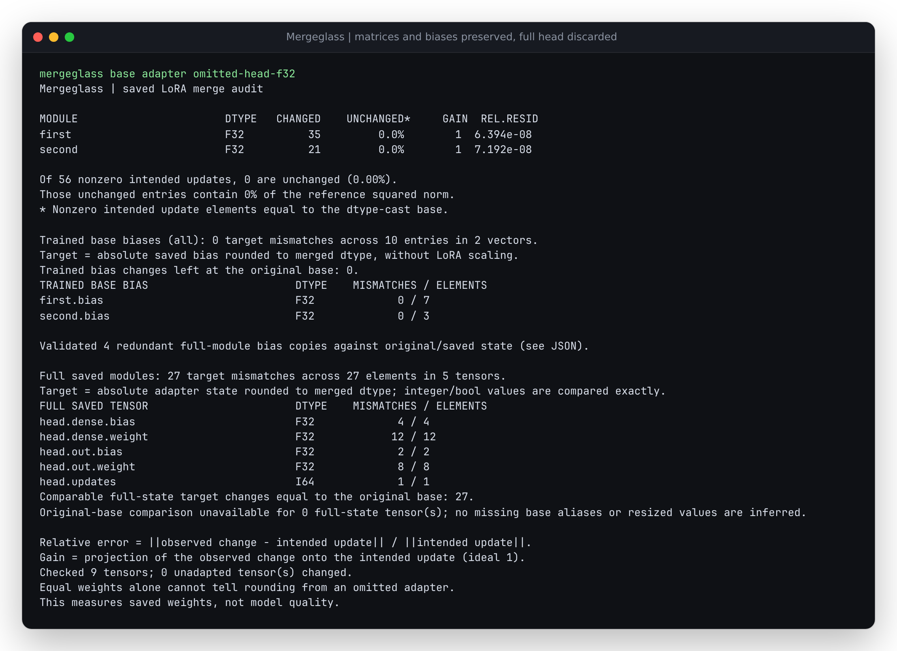

# Train the bias. Save the head. Check both.

A PEFT adapter can train original biases and save a complete classifier head
at the same time. These are separate targets. `modules_to_save=["head"]`
contains the head's complete state; `bias="all"` also exports redundant copies
under PEFT wrappers. Ignoring those copies would leave some input bytes
unvalidated. Counting them as additional output biases would double-count the
physical head.

Mergeglass now accepts complete trained-bias adapters combined with full saved
modules. It measures each physical tensor once and separately validates the
redundant wrapper copies. The first trained-bias implementation refused this
combination. The new support was checked against actual PEFT 0.21.2 output,
including its retained adapter-name component for nested saved modules.

```text
Saved adapter                         Audit reference
-----------------------------------   ----------------------------------
first.lora_A/B.weight                 LoRA matrix update
first.base_layer.bias                 Absolute trained first.bias
head.dense.weight / bias / updates    Complete absolute saved head
head.original_module.dense.bias       Original base head.dense.bias
head.modules_to_save.default...bias   Canonical saved head.dense.bias
```

All adapter paths above have the prefix `base_model.model.`. Exact names,
shapes, source identity and comparisons remain inspectable in JSON.

## Operate the omission

From the repository root after `uv sync --locked`:

```sh
uv run mergeglass examples/trained-bias-head/base examples/trained-bias-head/adapter examples/trained-bias-head/omitted-head-f32
```



This synthetic nested-head control preserves both correct LoRA matrices and
all ten trained biases outside the head. It restores only the head's complete
original state. The auditor finds 27 full-head target mismatches, including an
integer counter whose expected and observed values differ above `2**53`:

```text
expected head.updates = 1152921504606846988 = 2^60 + 12
saved   head.updates = 1152921504606846976 = 2^60
```

The counter increments once per training forward; it is not used to calculate
predictions. It tests complete saved-state identity without converting integer
values through floating point.

Replace the final input with `examples/trained-bias-head/reloaded-f32-safe-false`
for the correct native merge. Replace the adapter with
`examples/trained-bias-head/conflicting-modules_to_save-adapter` to inspect a
refusal caused by a wrapper copy that contradicts the canonical saved target.
A contradictory redundant copy is an inconsistent artifact, not a model-quality
diagnosis.

## Native production and independent checks

The producer uses original random models and authored random inputs/targets,
twelve AdamW steps, rank/alpha overrides, and native PEFT merging. The nested
profile also uses rsLoRA; another uses Linear DoRA. There are no pretrained
weights, downloaded datasets, incident-rate estimates or task-quality scores.

| Profile | Bias mode | Full head | Redundant copies |
| --- | --- | --- | ---: |
| all-head | all | Linear | 2 |
| lora-only-head | lora_only | Linear | 0 |
| dora-all-head | all | Linear, beside DoRA targets | 2 |
| nested-all-head | all | Two Linear layers and integer buffer | 4 |

Each profile contains all six FP32/FP16/BF16 and safe-merge combinations, an
in-memory FP32 merge, omitted/scaled-bias controls, and a complete-head omission:
40 measured outputs in total. Six authored contradictory-copy adapters must
refuse. The independent oracle checks 910 physical target entries and 200
redundant-copy entries across the complete matrix. Its stdlib byte reader and
scalar rounding are shared with the earlier bias study; no auditor mapping,
storage or numerical helper constructs the expected targets. Integer buffers
are decoded as integers.

Every floating output dtype is checked against its precision label. Exact
manifest coverage, all native combinations, all controls and every conflict
case are required. Checks remain active with `python -O`. Matrix bytes are
independently compared with native output to confirm that the authored faults
change only their declared tensors. The retained numerical report is
[results/native.json.gz](results/native.json.gz).

Replay the small retained native weights without Torch or PEFT:

```sh
mkdir -p /tmp/trained-bias-heads
tar -xzf studies/trained-bias-heads/artifacts/native.tar.gz -C /tmp/trained-bias-heads
uv run python -O studies/trained-bias-heads/verify.py /tmp/trained-bias-heads /tmp/trained-bias-heads.json.gz
```

The archive has 69 fingerprinted producer files. It records the complete actual
producer dependency set and forward differences. PEFT 0.21.2, Transformers
5.20.1, Torch 2.9.1+cpu and Python 3.12.12 produced these bytes. Native FP32
reload differences are zero in all four profiles.

To regenerate the study, use the separate producer environment described in
the [earlier study](../trained-bias/README.md#replay-without-a-model-runtime):

```sh
HF_HUB_OFFLINE=1 /tmp/trained-bias-producer/bin/python studies/trained-bias-heads/produce.py /tmp/trained-bias-heads-new
uv run python -O studies/trained-bias-heads/verify.py /tmp/trained-bias-heads-new /tmp/trained-bias-heads-new.json.gz
```

## Validation and limits of redundant copies

A canonical full-module tensor must be present even when a wrapper copy exists.
The active copy must numerically equal that canonical saved state rounded to
the copy dtype. The `original_module` copy must equal the supplied original base
rounded to its dtype. Every value is read in bounded blocks and checked for
finiteness. The report's `saved_bias_aliases` records the exact copy, reference,
reference kind and dtype comparison; summary and CLI report the copy count.
Copies do not inflate trained-bias or full-module output totals.

Named and unnamed active-copy formats are accepted only for the exact known
module and tensor suffix. More than one active copy, a reused copy, a collision
with a canonical full target, unavailable original evidence, unknown state,
shape/dtype disagreement or contradictory values refuses the audit. Equality
alone does not resolve ambiguous key ownership.

This is a conservative snapshot contract. A deliberately modified inactive
`original_module` backup is refused even when it could not change inference.
Missing/resized original state cannot validate an emitted backup copy; it is
not reconstructed. This does not broaden support for quantization, arbitrary
adapter variants, combined LoRA B biases, expert parameter adapters or
base-independent trained-bias auditing. Explicit full-module targets retain
their existing added/resized-state support where no unverifiable copy is emitted.

## Wide-head memory experiment

`wide.py` optionally trains a native model with a 4096 by 4096 full saved head
and both bias mechanisms above (absolute original biases and full-module
state). It writes approximately 193 MiB of local synthetic weights:

```sh
HF_HUB_OFFLINE=1 /tmp/trained-bias-producer/bin/python studies/trained-bias-heads/wide.py /tmp/trained-bias-wide
uv run mergeglass /tmp/trained-bias-wide/base /tmp/trained-bias-wide/adapter /tmp/trained-bias-wide/merged --block-mib 1 --max-adapter-mib 1 --summary
```

The large weights are not bundled. The small retained native study is the
replayable numerical evidence; the optional large producer exercises the
bounded full-state and redundant-copy paths. A dense float64 head alone would
require 128 MiB. Memory/timing observations include interpreter and library
resident memory and are specific to the recorded process and machine.
