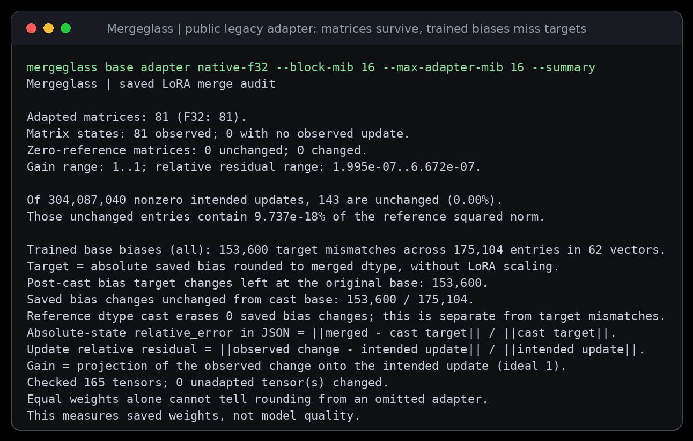

# Correct matrix updates. Missing trained biases.

A public CodeGen adapter has `bias="all"` and 62 saved absolute bias vectors.
With the pinned inputs below, PEFT 0.21.2 loads its LoRA factors, but misses
41 legacy bias vectors on wrapped Linear modules. A native FP32 merge contains
all 81 matrix updates and still differs from **153,600 saved bias targets**.
The other 21 bias vectors, on LayerNorm modules, load correctly.

This is a measured compatibility result for these artifacts and versions.
It is not an inference-quality evaluation or an estimate of how common this
problem is. The original training base revision is unspecified. Matrix and
base-change measurements here use the explicitly pinned supplied base;
absolute saved-bias target comparisons do not require guessing that revision.



[Unedited captured terminal output](../../docs/assets/trained-bias-public.txt).
The capture uses the installed Python 3.10 wheel of runtime `4578392`.

## Inputs and representation

| Role | Repository | Pinned revision | Model-card license label |
| --- | --- | --- | --- |
| Adapter | [ammarnasr/codegen-350M-mono-java](https://huggingface.co/ammarnasr/codegen-350M-mono-java/tree/f2fdfe8b4aee794df58b2b65cc7ed6ea386f243e) | `f2fdfe8b4aee794df58b2b65cc7ed6ea386f243e` | MIT |
| Supplied base | [Salesforce/codegen-350M-mono](https://huggingface.co/Salesforce/codegen-350M-mono/tree/d9107f71cca463240db1143f4a75a927a27fcb27) | `d9107f71cca463240db1143f4a75a927a27fcb27` | BSD-3-Clause |

[Exact immutable file URLs, sizes and SHA-256 digests](sources.json) cover the
original configurations, model cards and both pickle checkpoints (895 MB total
for the weight files). The producer verifies those identities before
`torch.load(weights_only=True)`. It disables remote model code. Large third-party
weights and generated checkpoints are not included in this repository.

The native loader receives the **original adapter `.bin` and configuration**.
For Mergeglass, the producer converts the adapter to safetensors and checks
all 224 names, dtypes and tensor values against the original. Its 162 factor
tensors and 62 bias vectors retain their original keys. This is a lossless
format conversion, not a repaired audit input.

The producer checks all 165 persistent native base tensors (356,712,448 values)
against the original checkpoint widened to FP32 before serializing them.
Twenty raw cached attention causal-mask buffers are absent from current
Transformers persistent state. The receipt lists their exact names, shapes and
dtypes. No new native base tensors appear. This is a checked persistent-state
representation, not byte identity with the original pickle checkpoint.

## Isolate the failure

```text
Original .bin -> native PEFT loading -> inspect live biases -> native merge
                      |                       |                  |
                      |                  already missing    still missing
                      |
Derived control: 41 key names gain ".base_layer"; no tensor values change
                      |
                 all 62 biases load -> native merge -> all 62 targets match
```

The original keys include
`base_model.model.transformer.h.0.mlp.fc_in.bias`. The key-only control uses
`base_model.model.transformer.h.0.mlp.fc_in.base_layer.bias` instead. Its 41
changes cover 20 `fc_in`, 20 `fc_out` and `lm_head` biases. All factor keys,
tensor payloads and adapter configuration bytes remain identical.

The producer checks every live factor against the raw source and every loaded
bias before and after merging. The independent verifier additionally hashes
all 103 non-bias persistent tensor payloads: the native FP32, mapped FP32 and
omission-control outputs match exactly there. Thus the mapped control changes
only biases; its matrix updates are not a different merge approximation.
This control is an explicit study input. Mergeglass does not rewrite adapters.

## Measured outputs

Every row audits 81 matrices, 62 bias vectors and all 165 persistent tensors.
Every row has 175,104 saved bias values different from the supplied source base.

| Output | Saved-bias target mismatches | Saved changes left at cast base | Reference-cast erasures |
| --- | ---: | ---: | ---: |
| Original adapter, native FP32 | 153,600 | 153,600 | 0 |
| Original adapter, native FP16 | 153,312 | 153,739 | 427 |
| Original adapter, native BF16 | 150,217 | 154,736 | 4,519 |
| FP32 control restoring every base bias | 175,104 | 175,104 | 0 |
| Explicit mapped-key FP32 control | 0 | 0 | 0 |

The lower-precision target-mismatch count is smaller partly because rounding
makes some distinct source values equal. It does not show a better bias load.
For example, an omitted source change can coincide with a reference-cast
erasure. These columns overlap; do not add them.

The FP32 matrix-update relative residuals range from about `2.0e-7` to `6.7e-7`;
gains print as 1. There are 304,087,040 intended nonzero matrix entries, of
which 143 are unchanged. No unadapted tensor changes. Those results coexist
with the bias failure and are not a claim of exact ideal-arithmetic equality.

[Retained compressed evidence](results/public.json.gz) contains all five full
reports, producer observations and generated file identities. The independent
oracle checks **875,520 bias coordinates**, including source-change, cast-erasure,
target-mismatch and first-witness fields. It separately checks 206 non-bias
control tensor payloads. It does not independently recompute the large matrix
products; matrix measurements are Mergeglass report output.

## Reproduce

Use Python 3.12 with enough space for the approximately 900 MB raw inputs and
about 8 GB of generated checkpoints. Torch is only needed for production.
The tested environment is Torch `2.9.1+cpu`, Transformers `5.20.1`, PEFT `0.21.2`,
and safetensors `0.8.0`. The adapter's original training library versions are
unknown. Changing these libraries can change the observed loading behavior.

```sh
uv venv --python 3.12 /tmp/public-bias-producer
uv pip install --python /tmp/public-bias-producer/bin/python 'torch==2.9.1+cpu' --index-url https://download.pytorch.org/whl/cpu
uv pip install --python /tmp/public-bias-producer/bin/python 'peft==0.21.2' 'transformers==5.20.1' 'safetensors==0.8.0'
/tmp/public-bias-producer/bin/python studies/trained-bias-public/produce.py /tmp/public-bias-cache /tmp/public-bias-output
uv sync --locked
OPENBLAS_NUM_THREADS=1 uv run python -O studies/trained-bias-public/verify.py /tmp/public-bias-output /tmp/public-bias-report.json.gz
uv run mergeglass /tmp/public-bias-output/base /tmp/public-bias-output/adapter /tmp/public-bias-output/native-f32 --block-mib 16 --max-adapter-mib 16 --summary
```

Use a new output directory. Cached raw files are rehashed on every producer run.
The verifier requires the full five-output matrix and exact manifest coverage,
checks all file hashes by streaming, and decodes only small bias vectors.
Its checks remain active under `python -O`. Large matrix payloads are hashed
in bounded blocks, not decoded into Python lists. The runtime audit's 16 MiB
adapter cap accommodates this adapter's fixed factor slices; it is not a
whole-checkpoint RAM limit.

## Publication evidence

The [immutable-source receipt](results/publication.json) records all 80 files
changed since the previous remote baseline at commit `0d767ab`: 1,767,034 bytes
were downloaded from GitHub and matched to Git blobs, including this study's
reports and inspected capture. The remote `main` reference matched that commit.
The subsequent receipt-only documentation commit is outside that inventory.
The corresponding hosted CI run executed zero steps; it supplies no hosted
validation. Clean-build and installed-package results are recorded separately
in the [self-audit evidence](../trained-bias/audit-verification.md).
