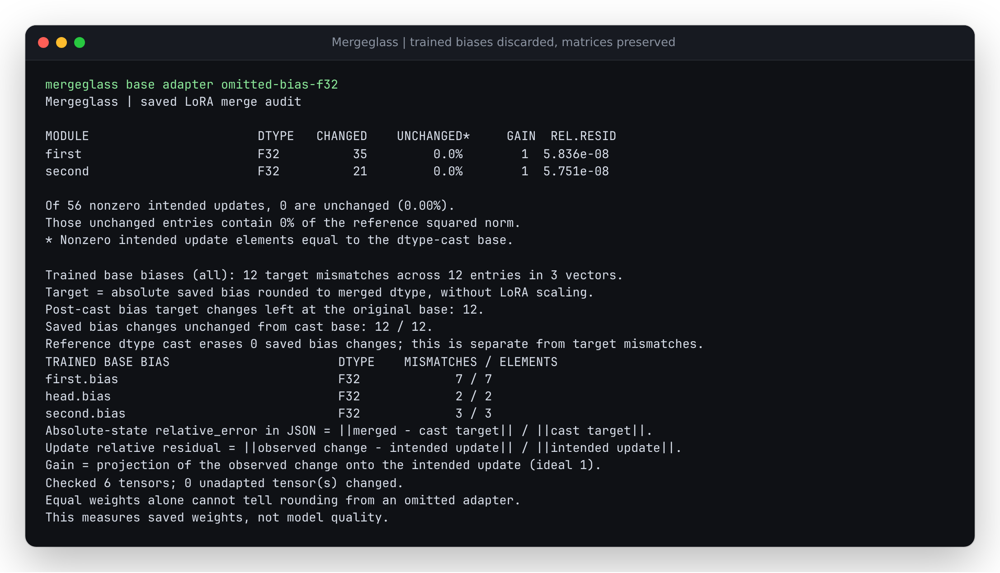

# The matrix merged. Did the trained bias survive?

PEFT has two different bias settings. `bias="all"` or `"lora_only"` trains
original model biases and saves their **absolute values**. `lora_bias=true`
adds a bias to the low-rank B projection; that bias is **scaled and added**
to the original bias. Treating those payloads alike produces a wrong merge.

| Payload | Reference saved value |
| --- | --- |
| Ordinary LoRA matrix | cast(base + scale * B @ A) |
| Trained original bias | cast(saved adapter bias) |
| LoRA B bias | cast(base bias + scale * saved B bias) |
| Full saved module | cast(complete saved module state) |

Here `cast` means round to the merged tensor's dtype. Integer/bool full-module
state follows its separate exact contract. Matrix orientation and DoRA
normalization follow the existing layout-specific references.

## Run the actual omission

From the repository root after `uv sync --locked`:

```sh
uv run mergeglass examples/trained-bias/base examples/trained-bias/adapter examples/trained-bias/omitted-bias-f32
```

Both synthetic trained LoRA matrices have gain 1 and FP32 residuals below
`6e-8`. All 12 trained bias entries are nevertheless wrong, left at the
original base values. The head's two biases matter even though the head has
no LoRA factors. The saved matrices in the authored omission and scaling
faults are byte-identical to the native FP32 merger's matrices.



Replace the last input with `examples/trained-bias/reloaded-f32-safe-false`
for zero bias target mismatches, or `examples/trained-bias/scaled-bias-f32`
for the explicit fault that multiplies absolute biases by three.
[Captured unedited CLI output](results/omitted.txt).

## What was actually produced

`probe.py` initializes and trains small synthetic models for twelve AdamW steps
on authored random inputs/targets. The initial base weights are rounded to BF16
and restored to FP32 before training. Native PEFT performs every normal merge.
The omission/scaling controls start from its FP32 result and change only biases.
These are demonstrations, not a measured incident rate or model-quality study.

Two independently produced sets retain complete saved bytes:

| Producer | Adapter profiles | Measured comparisons | Refused comparisons | Independently checked bias entries |
| --- | --- | ---: | ---: | ---: |
| PEFT 0.21.2, Transformers 5.20.1 | all, lora_only, DoRA all, GPT-2 Conv1D all | 36 | 0 | 1422 |
| PEFT 0.18.1, Transformers 4.57.3 | same profiles, plus explicitly captured complete historical adapter | 37 | 10 | 1432 |

Both use Torch 2.9.1+cpu, Python 3.12.12, one Torch thread and deterministic
algorithms. Every profile has native FP32, FP16 and BF16 saves, each with
`safe_merge` false and true; an in-memory FP32 merge; and the two authored
faults. `observations.json` records reload/merge forward differences on the
same synthetic input. The modern profiles' FP32 reload differences are zero.

| Modern profile | Bias vectors | Entries | Correct FP32 mismatches | Omitted mismatches | Scaled mismatches |
| --- | ---: | ---: | ---: | ---: | ---: |
| Affine, all | 3 | 12 | 0 | 12 | 12 |
| Affine, lora_only | 2 | 10 | 0 | 10 | 10 |
| Affine DoRA, all | 3 | 12 | 0 | 12 | 12 |
| GPT-2 Conv1D, all | 7 | 124 | 0 | 124 | 124 |

The GPT-2 case includes LayerNorm biases outside the adapted Conv1D modules.
The verifier checks the observations' complete list of trainable biases,
independently decodes the safetensors bytes, rounds saved targets with scalar
standard-library operations, and checks counts, first mismatch coordinates,
error norms and original-base equality. It imports no NumPy, Torch, PEFT or
Mergeglass storage helpers for these calculations. Report generation itself
uses Mergeglass. The independent oracle concerns biases; existing matrix
oracles remain separate.

## A historical adapter can be incomplete

In PEFT 0.18.1, `bias="lora_only"` trained two base biases but
`save_pretrained` omitted them. In this retained run, native reload changes
outputs by a maximum absolute `0.3914169669151306` in FP32. This is a
version-specific serialization observation, not a claim about current PEFT:
0.21.2 saves both biases and reproduces the original outputs in the same study.
Compare the upstream serialization implementations at
[v0.18.1](https://github.com/huggingface/peft/blob/v0.18.1/src/peft/utils/save_and_load.py)
and [v0.21.2](https://github.com/huggingface/peft/blob/v0.21.2/src/peft/utils/save_and_load.py).
[Upstream report and discussion](https://github.com/huggingface/peft/issues/3306).

The included incomplete historical example exits 2 with a specific missing
trained-bias error:

```sh
uv run mergeglass examples/trained-bias/historical-base examples/trained-bias/incomplete-historical-adapter examples/trained-bias/historical-in-memory-f32
```

The study also captures those two trained values **from the still-live trained
model** into a separately named `captured-complete-adapter`. This is an authored
recovery control, not an unchanged native export and not a method for recovering
lost values from the original base. Native reload from that complete control
matches the trained model exactly. Auditing it against a merge made from the
incomplete export identifies all ten omitted entries. The ten refused cases
use the incomplete export; the ten measured historical lora_only cases use
the explicitly complete control against the same outputs.

## Replay without a model runtime

The archives contain only small synthetic weights, metadata, full dependency
version lists and per-file SHA-256 manifests. No third-party model weights are
redistributed. From the repository root:

```sh
mkdir -p /tmp/trained-bias-modern /tmp/trained-bias-historical
tar -xzf studies/trained-bias/artifacts/modern.tar.gz -C /tmp/trained-bias-modern
tar -xzf studies/trained-bias/artifacts/historical.tar.gz -C /tmp/trained-bias-historical
uv run python studies/trained-bias/verify.py /tmp/trained-bias-modern /tmp/trained-bias-modern.json.gz
uv run python studies/trained-bias/verify.py /tmp/trained-bias-historical /tmp/trained-bias-historical.json.gz
```

This verifies 73 modern and 76 historical file identities before comparing
values. Complete retained reports: [modern](results/modern.json.gz) and
[historical](results/historical.json.gz). Hashes, counts and coordinates can be
replayed without the producer dependencies.

To regenerate modern weights, create a separate producer environment:

```sh
uv venv --python 3.12 /tmp/trained-bias-producer
uv pip install --python /tmp/trained-bias-producer/bin/python torch==2.9.1 --index https://download.pytorch.org/whl/cpu
uv pip install --python /tmp/trained-bias-producer/bin/python peft==0.21.2 transformers==5.20.1
HF_HUB_OFFLINE=1 /tmp/trained-bias-producer/bin/python studies/trained-bias/probe.py /tmp/trained-bias-new
uv run python studies/trained-bias/verify.py /tmp/trained-bias-new /tmp/trained-bias-new.json.gz
```

For the historical producer use a fresh environment with `peft==0.18.1` and
`transformers==4.57.3`. Each archive's `environment.txt` records the complete
actual dependency set. Regeneration with different transitive versions or
hardware may change training bytes; replaying retained bytes is the exact
identity check.

## Audit scope

`trained_biases` is an additive schema-1 report field. Each row retains its
original saved tensor name, dtype/shape, target mismatches, first mismatch
index and values, absolute-target error norm and original-base comparisons.
Its `relative_error` divides the absolute target error by the target norm,
not by the trained change. Zero targets have no relative ratio. Matrix and
LoRA B-bias counts remain separate. Both full and summary CLI output include
the trained-bias mismatch total. Ordinary `bias="none"` report fields remain
unchanged.

Only exact literal bias vectors and an observed adapter module's `base_layer`
wrapper are accepted. `all` requires every observable base bias; `lora_only`
requires biases of the modules established by saved A/B factors. Missing,
ambiguous, nonfinite, mismatched or unexplained payloads refuse the entire
audit. Biasless models have no invented bias vectors. No tied alias, architecture
or missing trained value is reconstructed.

Trained-base-bias combinations with `modules_to_save`, `lora_bias`, expert
parameter adapters, and the base-independent DoRA mode remain unsupported.
Names containing `bias` outside a literal floating bias-vector layout also
refuse under `all`: PEFT's broad substring selection can save other parameters.
The extension adds no runtime dependency, downloads or input writes. No registry
release accompanies these source changes.
