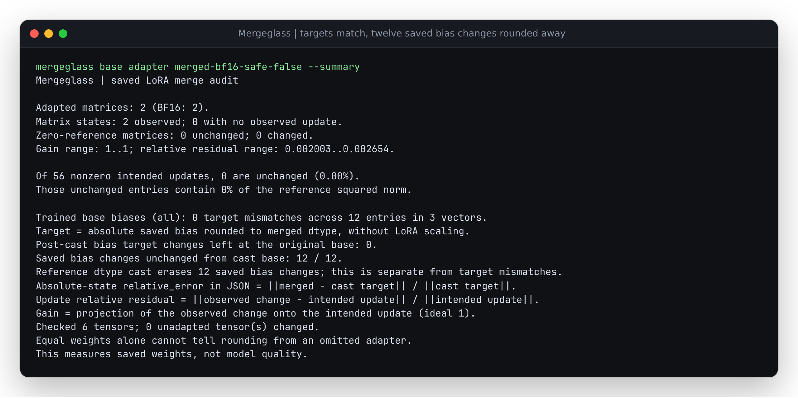

# A correct dtype cast can erase every saved bias change

The first bias audit compared the merged tensor with the saved adapter target
rounded to the merged dtype. That target comparison remains correct. Its CLI
label, "Trained bias changes left at the original base", was misleading because
the count considered only changes that survived the reference cast.

In a reproduced native BF16 control, twelve saved biases differ from the
original base and all twelve merged values equal that base. The earlier CLI
nevertheless printed zero changes left at the base, alongside zero target
mismatches. The retained [before receipt](results/precision-before.json) and
[unedited before output](results/precision-before.txt) record that behavior at
source commit `258959c`.

The report now separates saved changes, reference-cast erasure, final observed
equality, and target mismatches, with exact original coordinates and values.

```text
Original base b -------- cast to merged dtype -------> b'
Saved adapter target s - cast to merged dtype -------> s'
Actual saved merge ----------------------------------> m

Compare s with b, s' with b', and m with each cast value.
```

| JSON row field | Counted condition |
| --- | --- |
| `saved_change_elements` | s differs from b |
| `cast_erased_change_elements` | s differs from b, but s' equals b' |
| `unchanged_saved_change_elements` | s differs from b, and m equals b' |
| `target_mismatches` | m differs from s' |
| Existing `expected_change_elements` | s' differs from b' |
| Existing `unchanged_expected_change_elements` | s' differs from b', and m equals b' |

All comparisons are numeric equality, with the supplied original base and saved
adapter values widened exactly where supported. Source changes are compared
directly rather than subtracted, so an extreme finite pair does not introduce
an overflowing difference. Integer/bool comparisons retain their exact type;
their unchanged-dtype reference cast erases no values. An unavailable original
base comparison leaves all three new counts null.

`first_unchanged_saved_change` and `first_cast_erased_change` preserve the first
original flat index, source base, saved target, both cast values, actual merged
value and the reference-erasure flag. Reference-cast erasure and final observed
equality are separate sets: an unrelated final edit can move an erased
coordinate away from the cast base. The witnesses expose that difference.

## Operate the native precision control

From the repository root after `uv sync --locked`:

```sh
uv run mergeglass examples/trained-bias-precision/base examples/trained-bias-precision/adapter examples/trained-bias-precision/merged-bf16-safe-false --summary
```



Switch the final input to `examples/trained-bias-precision/merged-f32-safe-false`
to retain all twelve saved bias changes. Neither native output has a bias target
mismatch. The saved LoRA factors remain their trained values throughout.

| Native output | Saved bias changes | Unchanged saved bias changes | Reference cast erases | Bias target mismatches |
| --- | ---: | ---: | ---: | ---: |
| FP32 | 12 | 0 | 0 | 0 |
| FP16 | 12 | 12 | 12 | 0 |
| BF16 | 12 | 12 | 12 | 0 |

A second profile combines ten ordinary bias changes with eight complete saved
head changes. FP32 retains them; FP16 and BF16 erase all eighteen, while every
absolute target comparison still matches. Both safe-merge modes are retained.

## What the control establishes

`precision.py` trains original small synthetic models for eight AdamW steps.
The initial base values are BF16-exact values stored in FP32. After training,
each controlled bias or full-head parameter is moved to the immediately
adjacent FP32 value from its original base, in the direction of its trained
value. The producer refuses a value with no trained direction. LoRA factors
are left unchanged. This is an explicit authored post-training scale control,
not a naturally observed adapter or a measured incident rate.

Native PEFT 0.21.2 creates the saved adapters and FP32/FP16/BF16 merges.
Transformers 5.20.1, Torch 2.9.1+cpu and Python 3.12.12 were used. Reference-cast
erasure describes these supplied files and dtype. It does not locate the phase
in which a producer rounded the values, recover unseen training precision, or
measure inference quality. In particular, loading absolute biases into a
lower-precision base can already round them before the merge operation.

The independently decoded scalar oracle verifies every source/cast/observed
condition and every witness across twelve native cases and 180 physical entry
comparisons. It also requires the full precision/safe-merge matrix and exact
manifest coverage, with checks active under optimized Python. All existing
post-cast fields keep their definitions; the schema-1 additions do not reinterpret
older report data. The CLI renders older reports without inventing missing
source-change counts.

Replay without Torch or PEFT:

```sh
mkdir -p /tmp/trained-bias-precision
tar -xzf studies/trained-bias/artifacts/precision.tar.gz -C /tmp/trained-bias-precision
uv run python -O studies/trained-bias/verify_precision.py /tmp/trained-bias-precision /tmp/trained-bias-precision.json.gz
```

The archive contains 21 fingerprinted producer files. The complete retained
[oracle report](results/precision.json.gz) includes the new counts and witnesses.
Regenerate with the separately installed producer environment from the main
study:

```sh
HF_HUB_OFFLINE=1 /tmp/trained-bias-producer/bin/python studies/trained-bias/precision.py /tmp/trained-bias-precision-new
uv run python -O studies/trained-bias/verify_precision.py /tmp/trained-bias-precision-new /tmp/trained-bias-precision-new.json.gz
```
